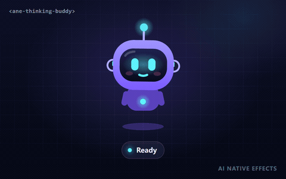
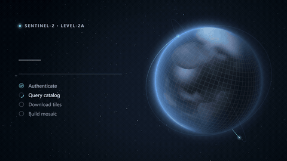
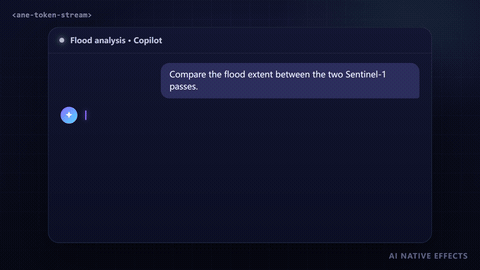

<div align="center">

<a href="https://anticipate218.github.io/ai-native-effects/"></a>

# AI Native Effects

**Make the invisible work of AI visible.**

Animated, accessible Web Components that turn the states of AI systems (thinking, planning, tool calls, loading, failure) into readable, delightful UI.

[**Live demo**](https://anticipate218.github.io/ai-native-effects/) · [Playground](https://anticipate218.github.io/ai-native-effects/effects/thinking-buddy.html) · [Docs](docs/effects/thinking-buddy.md) · [中文文档](README.zh-CN.md)

[](https://github.com/anticipate218/ai-native-effects/actions/workflows/ci.yml)
[](LICENSE)


</div>

## Why AI-native effects?

A spinner only says *something is happening*. AI products need to say **what** is happening: is the model thinking, waiting on a tool, waiting for the user's approval, done, or stuck? These states are the heartbeat of every chat assistant and agent, yet most interfaces render them as the same grey loader.

AI Native Effects is a library of small, production-ready components built for exactly those moments. Each one is a standard Custom Element, so it drops into React, Vue, Svelte, Angular or plain HTML, and each one meets the same bar for accessibility, performance and mobile support.

## Effects

<!-- effects:start -->
<table>
  <tr>
    <td width="50%" valign="top">
      <a href="https://anticipate218.github.io/ai-native-effects/effects/thinking-buddy.html"></a>
      <br><b><a href="https://anticipate218.github.io/ai-native-effects/effects/thinking-buddy.html">AI Thinking Buddy</a></b> · <code>&lt;ane-thinking-buddy&gt;</code> · <sub>AI Native</sub>
      <br><sub>A tiny robot that makes agent status readable at a glance: idle, thinking, waiting, success and error, each with its own body language.</sub>
      <br><sub><a href="https://anticipate218.github.io/ai-native-effects/effects/thinking-buddy.html">Playground</a> · <a href="docs/effects/thinking-buddy.md">Docs</a> · <a href="src/effects/thinking-buddy">Source</a></sub>
    </td>
    <td width="50%" valign="top">
      <a href="https://anticipate218.github.io/ai-native-effects/effects/orbit-loading-screen.html"></a>
      <br><b><a href="https://anticipate218.github.io/ai-native-effects/effects/orbit-loading-screen.html">Orbit Loading Screen</a></b> · <code>&lt;ane-orbit-loading-screen&gt;</code> · <sub>AI Native</sub>
      <br><sub>A full loading screen for data-heavy AI and geo apps: a WebGL planet sharpens tile by tile as data arrives, next to a typographic panel with progress, steps and live details.</sub>
      <br><sub><a href="https://anticipate218.github.io/ai-native-effects/effects/orbit-loading-screen.html">Playground</a> · <a href="docs/effects/orbit-loading-screen.md">Docs</a> · <a href="src/effects/orbit-loading-screen">Source</a></sub>
    </td>
  </tr>
  <tr>
    <td width="50%" valign="top">
      <a href="https://anticipate218.github.io/ai-native-effects/effects/token-stream.html"></a>
      <br><b><a href="https://anticipate218.github.io/ai-native-effects/effects/token-stream.html">Token Stream Text</a></b> · <code>&lt;ane-token-stream&gt;</code> · <sub>AI Native</sub>
      <br><sub>Streamed LLM text that writes itself smoothly: bursty chunks are paced adaptively and each word rises out of a blur and dries from the accent color behind a glowing caret.</sub>
      <br><sub><a href="https://anticipate218.github.io/ai-native-effects/effects/token-stream.html">Playground</a> · <a href="docs/effects/token-stream.md">Docs</a> · <a href="src/effects/token-stream">Source</a></sub>
    </td>
    <td width="50%"></td>
  </tr>
</table>
<!-- effects:end -->

More effects are on the way: an agent flow visualizer and a diffusion-style image reveal. See the [roadmap](#roadmap).

## Quick start

### From a CDN (no build step)

```html
<script type="module" src="https://anticipate218.github.io/ai-native-effects/cdn/effects/thinking-buddy.js"></script>

<ane-thinking-buddy state="thinking"></ane-thinking-buddy>
```

### With npm

The package installs straight from GitHub (the library is built on install):

```bash
npm install github:anticipate218/ai-native-effects
```

```ts
import 'ai-native-effects/thinking-buddy'; // registers <ane-thinking-buddy>

const buddy = document.querySelector('ane-thinking-buddy')!;
buddy.state = 'thinking';
const result = await runAgent();
buddy.state = result.ok ? 'success' : 'error';
```

Import `ai-native-effects` to register every effect, or `ai-native-effects/<effect-id>` to ship only what you use.

### In your framework

<details>
<summary><b>React 19</b></summary>

```tsx
import 'ai-native-effects/thinking-buddy';

export function AgentStatus({ state }: { state: 'idle' | 'thinking' | 'waiting' | 'success' | 'error' }) {
  return <ane-thinking-buddy state={state} size="96px" />;
}
```

TypeScript users can declare the element once, as shown in the [component docs](docs/effects/thinking-buddy.md#typescript-and-react).

</details>

<details>
<summary><b>Vue 3</b></summary>

```vue
<script setup lang="ts">
import 'ai-native-effects/thinking-buddy';
defineProps<{ state: string }>();
</script>

<template>
  <ane-thinking-buddy :state="state" />
</template>
```

Tell the compiler about custom elements: `compilerOptions.isCustomElement = (tag) => tag.startsWith('ane-')`.

</details>

<details>
<summary><b>Svelte, Angular, plain HTML</b></summary>

Custom Elements work natively. In Angular, add `CUSTOM_ELEMENTS_SCHEMA` to the component that uses them.

</details>

## Design principles

| | |
| --- | --- |
| **Framework-agnostic** | Standard Custom Elements with attributes, properties and DOM events. Safe to import during SSR. |
| **Accessible** | Meaningful `role`/`aria-label`, optional polite live announcements, and a calm variant for `prefers-reduced-motion` (or force it with `motion="reduce"`). |
| **Light on the main thread** | Zero runtime dependencies. All effects share one `requestAnimationFrame` loop that stops when nothing is visible; each element pauses while off-screen. |
| **Tunable** | Colors, size and speed via attributes or CSS custom properties (`--ane-*`). |
| **Deterministic** | Seeded randomness and a virtual-time capture pipeline: previews and tests are reproducible frame by frame. |

Every effect passes the same quality gate before it ships: unit tests, axe-core WCAG 2.2 AA checks, a per-frame JS budget, 320 px mobile layout, reduced-motion behaviour and off-screen pausing. See [`tests/e2e/site.spec.ts`](tests/e2e/site.spec.ts).

## Development

```bash
npm install
npm run dev        # showcase site with hot reload: http://localhost:5173
npm run check      # typecheck + unit tests + build + e2e quality gate
npm run capture    # re-record GIF / MP4 / poster previews (needs ffmpeg)
npm run new -- my-effect --title "My Effect"   # scaffold a new effect
npm run sync       # regenerate README effect tables from effects.json
```

Project layout:

```
src/core/            shared ticker, base element, motion + math helpers
src/effects/<id>/    one folder per effect (component, tests, entry)
site/                showcase site: gallery, playgrounds, capture stage + scenes
scripts/             capture, screenshots, scaffolding, README sync
docs/                component docs (English) and docs/zh-CN (中文)
effects.json         effect manifest: gallery, READMEs, tests and builds read it
```

## Roadmap

- [x] **AI Thinking Buddy**: robot with idle / thinking / waiting / success / error states
- [ ] **Agent Flow Visualizer**: live plan → tool call → result graph
- [x] **Orbit Loading Screen**: a full WebGL loading screen where the planet sharpens tile by tile
- [ ] **Image Reveal FX**: diffusion-style before/after reveal for image models
- [x] **Token Stream Text**: adaptive-paced streaming text with blur-to-sharp ink and a glowing caret
- [ ] React and Vue typed wrappers

Ideas and votes are welcome in [issues](https://github.com/anticipate218/ai-native-effects/issues).

## Contributing

Contributions are welcome. Please read [CONTRIBUTING.md](CONTRIBUTING.md): it covers the effect checklist, the quality gate and the licensing rules (original work only; credit any inspiration in [docs/CREDITS.md](docs/CREDITS.md)).

## License

[MIT](LICENSE) © 2026 anticipate218
