<div align="center">

<a href="https://anticipate218.github.io/ai-native-effects/">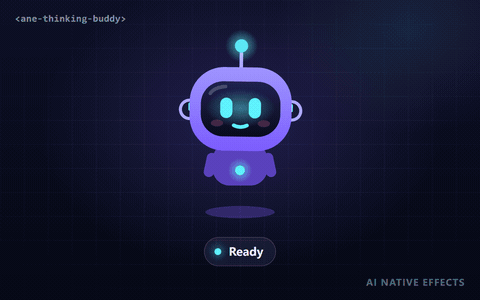</a>

# AI Native Effects

**Make the invisible work of AI visible.**

Animated, accessible Web Components that turn the states of AI systems (thinking, planning, tool calls, loading, failure) into readable, delightful UI.

[**Live demo**](https://anticipate218.github.io/ai-native-effects/) · [Playground](https://anticipate218.github.io/ai-native-effects/effects/thinking-buddy.html) · [Docs](docs/effects/thinking-buddy.md) · [中文文档](README.zh-CN.md)

[](https://github.com/anticipate218/ai-native-effects/actions/workflows/ci.yml)
[](LICENSE)


</div>

## Why AI-native effects?

A spinner only says *something is happening*. AI products need to say **what** is happening: is the model thinking, waiting on a tool, waiting for the user's approval, done, or stuck? These states are the heartbeat of every chat assistant and agent, yet most interfaces render them as the same grey loader.

AI Native Effects is a library of small, production-ready components built for exactly those moments. Each one is a standard Custom Element, so it drops into React, Vue, Svelte, Angular or plain HTML, and each one meets the same bar for accessibility, performance and mobile support.

## Effects

<!-- effects:start -->
<table>
  <tr>
    <td width="50%" valign="top">
      <a href="https://anticipate218.github.io/ai-native-effects/effects/thinking-buddy.html"></a>
      <br><b><a href="https://anticipate218.github.io/ai-native-effects/effects/thinking-buddy.html">AI Thinking Buddy</a></b> · <code>&lt;ane-thinking-buddy&gt;</code> · <sub>AI Native</sub>
      <br><sub>A tiny robot that makes agent status readable at a glance: idle, thinking, waiting, success and error, each with its own body language.</sub>
      <br><sub><a href="https://anticipate218.github.io/ai-native-effects/effects/thinking-buddy.html">Playground</a> · <a href="docs/effects/thinking-buddy.md">Docs</a> · <a href="src/effects/thinking-buddy">Source</a></sub>
    </td>
    <td width="50%" valign="top">
      <a href="https://anticipate218.github.io/ai-native-effects/effects/orbit-loading-screen.html">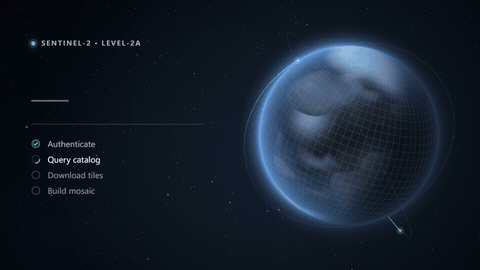</a>
      <br><b><a href="https://anticipate218.github.io/ai-native-effects/effects/orbit-loading-screen.html">Orbit Loading Screen</a></b> · <code>&lt;ane-orbit-loading-screen&gt;</code> · <sub>AI Native</sub>
      <br><sub>A full loading screen for data-heavy AI and geo apps: a WebGL planet sharpens tile by tile as data arrives, next to a typographic panel with progress, steps and live details.</sub>
      <br><sub><a href="https://anticipate218.github.io/ai-native-effects/effects/orbit-loading-screen.html">Playground</a> · <a href="docs/effects/orbit-loading-screen.md">Docs</a> · <a href="src/effects/orbit-loading-screen">Source</a></sub>
    </td>
  </tr>
  <tr>
    <td width="50%" valign="top">
      <a href="https://anticipate218.github.io/ai-native-effects/effects/token-stream.html">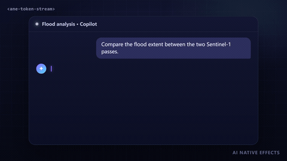</a>
      <br><b><a href="https://anticipate218.github.io/ai-native-effects/effects/token-stream.html">Token Stream Text</a></b> · <code>&lt;ane-token-stream&gt;</code> · <sub>AI Native</sub>
      <br><sub>Streamed LLM text that writes itself smoothly: bursty chunks are paced adaptively and each word rises out of a blur and dries from the accent color behind a glowing caret.</sub>
      <br><sub><a href="https://anticipate218.github.io/ai-native-effects/effects/token-stream.html">Playground</a> · <a href="docs/effects/token-stream.md">Docs</a> · <a href="src/effects/token-stream">Source</a></sub>
    </td>
    <td width="50%" valign="top">
      <a href="https://anticipate218.github.io/ai-native-effects/effects/scan-reveal.html">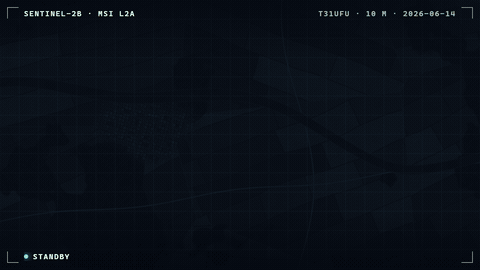</a>
      <br><b><a href="https://anticipate218.github.io/ai-native-effects/effects/scan-reveal.html">Satellite Scan Reveal</a></b> · <code>&lt;ane-scan-reveal&gt;</code> · <sub>Remote sensing × AI</sub>
      <br><sub>A push-broom satellite scan reveals the imagery, then a dashed inference sweep lays a land-cover mask over it. Bring your own image and mask, or use the procedural scene.</sub>
      <br><sub><a href="https://anticipate218.github.io/ai-native-effects/effects/scan-reveal.html">Playground</a> · <a href="docs/effects/scan-reveal.md">Docs</a> · <a href="src/effects/scan-reveal">Source</a></sub>
    </td>
  </tr>
  <tr>
    <td width="50%" valign="top">
      <a href="https://anticipate218.github.io/ai-native-effects/effects/agent-flow.html"></a>
      <br><b><a href="https://anticipate218.github.io/ai-native-effects/effects/agent-flow.html">Agent Flow Visualizer</a></b> · <code>&lt;ane-agent-flow&gt;</code> · <sub>AI Native</sub>
      <br><sub>A live flow graph of an agent run: plan, parallel tool calls, joins and the answer grow as events arrive, with running edges, durations and expandable results.</sub>
      <br><sub><a href="https://anticipate218.github.io/ai-native-effects/effects/agent-flow.html">Playground</a> · <a href="docs/effects/agent-flow.md">Docs</a> · <a href="src/effects/agent-flow">Source</a></sub>
    </td>
    <td width="50%" valign="top">
      <a href="https://anticipate218.github.io/ai-native-effects/effects/glass-lens.html">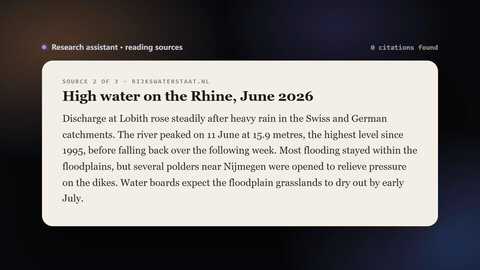</a>
      <br><b><a href="https://anticipate218.github.io/ai-native-effects/effects/glass-lens.html">Liquid Glass Lens</a></b> · <code>&lt;ane-glass-lens&gt;</code> · <sub>AI Native</sub>
      <br><sub>A liquid-glass lens that refracts the live content it wraps. In read mode it shows an AI reading: it glides along the text, dwells on cited passages and leaves them highlighted.</sub>
      <br><sub><a href="https://anticipate218.github.io/ai-native-effects/effects/glass-lens.html">Playground</a> · <a href="docs/effects/glass-lens.md">Docs</a> · <a href="src/effects/glass-lens">Source</a></sub>
    </td>
  </tr>
  <tr>
    <td width="50%" valign="top">
      <a href="https://anticipate218.github.io/ai-native-effects/effects/image-reveal.html">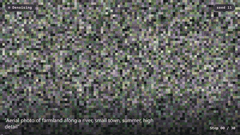</a>
      <br><b><a href="https://anticipate218.github.io/ai-native-effects/effects/image-reveal.html">Image Reveal FX</a></b> · <code>&lt;ane-image-reveal&gt;</code> · <sub>AI Native</sub>
      <br><sub>Image generation shown like a real diffusion sampler: noise removed step by step, coarse to fine, out of latent blocks, with a step counter and a before/after compare slider.</sub>
      <br><sub><a href="https://anticipate218.github.io/ai-native-effects/effects/image-reveal.html">Playground</a> · <a href="docs/effects/image-reveal.md">Docs</a> · <a href="src/effects/image-reveal">Source</a></sub>
    </td>
    <td width="50%" valign="top">
      <a href="https://anticipate218.github.io/ai-native-effects/effects/aurora.html">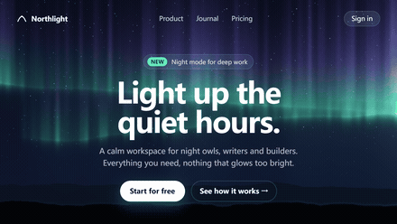</a>
      <br><b><a href="https://anticipate218.github.io/ai-native-effects/effects/aurora.html">Aurora Curtain</a></b> · <code>&lt;ane-aurora&gt;</code> · <sub>UI FX</sub>
      <br><sub>A realistic northern-lights hero background: curtains with rising rays, drifting folds that lean towards the pointer, twinkling stars and a mountain horizon. Your hero content stays plain HTML.</sub>
      <br><sub><a href="https://anticipate218.github.io/ai-native-effects/effects/aurora.html">Playground</a> · <a href="docs/effects/aurora.md">Docs</a> · <a href="src/effects/aurora">Source</a></sub>
    </td>
  </tr>
  <tr>
    <td width="50%" valign="top">
      <a href="https://anticipate218.github.io/ai-native-effects/effects/decrypt-text.html">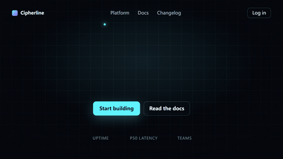</a>
      <br><b><a href="https://anticipate218.github.io/ai-native-effects/effects/decrypt-text.html">Decrypt Text</a></b> · <code>&lt;ane-decrypt-text&gt;</code> · <sub>UI FX</sub>
      <br><sub>Headlines that decode themselves out of width-matched scramble glyphs: no layout jitter, smooth morphs between strings, a glowing lock flash and CJK-aware scrambling.</sub>
      <br><sub><a href="https://anticipate218.github.io/ai-native-effects/effects/decrypt-text.html">Playground</a> · <a href="docs/effects/decrypt-text.md">Docs</a> · <a href="src/effects/decrypt-text">Source</a></sub>
    </td>
    <td width="50%" valign="top">
      <a href="https://anticipate218.github.io/ai-native-effects/effects/magnet-dock.html">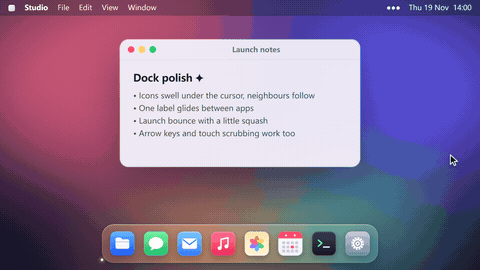</a>
      <br><b><a href="https://anticipate218.github.io/ai-native-effects/effects/magnet-dock.html">Magnetic Dock</a></b> · <code>&lt;ane-magnet-dock&gt;</code> · <sub>UI FX</sub>
      <br><sub>A spring-physics dock for any buttons or links: icons swell and lean towards the pointer, one label glides between them, launches bounce with squash and stretch, and keyboard focus and touch scrubbing magnify too.</sub>
      <br><sub><a href="https://anticipate218.github.io/ai-native-effects/effects/magnet-dock.html">Playground</a> · <a href="docs/effects/magnet-dock.md">Docs</a> · <a href="src/effects/magnet-dock">Source</a></sub>
    </td>
  </tr>
  <tr>
    <td width="50%" valign="top">
      <a href="https://anticipate218.github.io/ai-native-effects/effects/tilt-holo-card.html"></a>
      <br><b><a href="https://anticipate218.github.io/ai-native-effects/effects/tilt-holo-card.html">Holographic Tilt Card</a></b> · <code>&lt;ane-tilt-holo-card&gt;</code> · <sub>UI FX</sub>
      <br><sub>A card that tilts towards the pointer on springs, with a procedural holographic foil that shows a rainbow only where the light hits, an iridescent sheen, a moving glare and a shimmering rim. Any content inside; idle sway and optional gyroscope.</sub>
      <br><sub><a href="https://anticipate218.github.io/ai-native-effects/effects/tilt-holo-card.html">Playground</a> · <a href="docs/effects/tilt-holo-card.md">Docs</a> · <a href="src/effects/tilt-holo-card">Source</a></sub>
    </td>
    <td width="50%" valign="top">
      <a href="https://anticipate218.github.io/ai-native-effects/effects/spotlight-grid.html">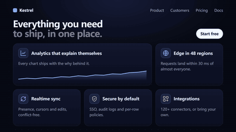</a>
      <br><b><a href="https://anticipate218.github.io/ai-native-effects/effects/spotlight-grid.html">Spotlight Grid</a></b> · <code>&lt;ane-spotlight-grid&gt;</code> · <sub>UI FX</sub>
      <br><sub>One shared light for a whole wall of cards: it follows the pointer with inertia, lights borders across the gaps, reveals a dot grid and sends a light wave through the wall on click. Idle drift, keyboard focus and touch.</sub>
      <br><sub><a href="https://anticipate218.github.io/ai-native-effects/effects/spotlight-grid.html">Playground</a> · <a href="docs/effects/spotlight-grid.md">Docs</a> · <a href="src/effects/spotlight-grid">Source</a></sub>
    </td>
  </tr>
  <tr>
    <td width="50%" valign="top">
      <a href="https://anticipate218.github.io/ai-native-effects/effects/ascii-field.html">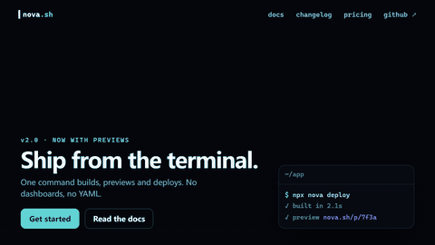</a>
      <br><b><a href="https://anticipate218.github.io/ai-native-effects/effects/ascii-field.html">ASCII Field</a></b> · <code>&lt;ane-ascii-field&gt;</code> · <sub>UI FX</sub>
      <br><sub>A flowing field of ASCII characters rendered by a fragment shader: brightness picks the glyph, the characters gather into words or images, light up under the pointer and ripple with a shock wave on click.</sub>
      <br><sub><a href="https://anticipate218.github.io/ai-native-effects/effects/ascii-field.html">Playground</a> · <a href="docs/effects/ascii-field.md">Docs</a> · <a href="src/effects/ascii-field">Source</a></sub>
    </td>
    <td width="50%" valign="top">
      <a href="https://anticipate218.github.io/ai-native-effects/effects/dither-gradient.html">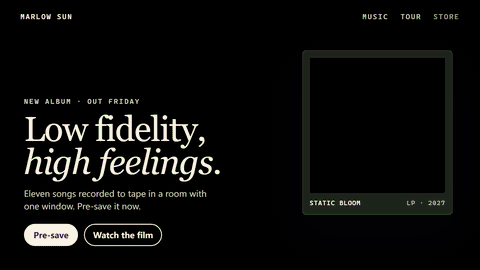</a>
      <br><b><a href="https://anticipate218.github.io/ai-native-effects/effects/dither-gradient.html">Dither Gradient</a></b> · <code>&lt;ane-dither-gradient&gt;</code> · <sub>UI FX</sub>
      <br><sub>A flowing gradient or any image rendered through a limited palette with Bayer or noise dithering (sunset, paper, Game Boy-style greens, mono, CGA-style…), with a lens that shows the smooth colours under the pointer.</sub>
      <br><sub><a href="https://anticipate218.github.io/ai-native-effects/effects/dither-gradient.html">Playground</a> · <a href="docs/effects/dither-gradient.md">Docs</a> · <a href="src/effects/dither-gradient">Source</a></sub>
    </td>
  </tr>
  <tr>
    <td width="50%" valign="top">
      <a href="https://anticipate218.github.io/ai-native-effects/effects/glass-tabs.html">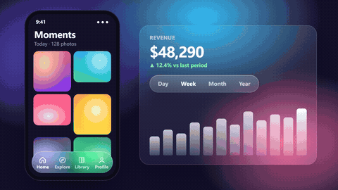</a>
      <br><b><a href="https://anticipate218.github.io/ai-native-effects/effects/glass-tabs.html">Glass Tabs</a></b> · <code>&lt;ane-glass-tabs&gt;</code> · <sub>UI FX</sub>
      <br><sub>A tab bar whose selected tab sits under a liquid-glass lens that really refracts and magnifies the labels beneath it, slides on a spring, stretches with its speed like a drop and can be dragged to scrub between tabs.</sub>
      <br><sub><a href="https://anticipate218.github.io/ai-native-effects/effects/glass-tabs.html">Playground</a> · <a href="docs/effects/glass-tabs.md">Docs</a> · <a href="src/effects/glass-tabs">Source</a></sub>
    </td>
    <td width="50%" valign="top">
      <a href="https://anticipate218.github.io/ai-native-effects/effects/hold-button.html">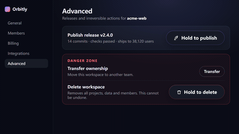</a>
      <br><b><a href="https://anticipate218.github.io/ai-native-effects/effects/hold-button.html">Hold to Confirm</a></b> · <code>&lt;ane-hold-button&gt;</code> · <sub>UI FX</sub>
      <br><sub>Press and hold to confirm irreversible actions: a liquid fill with a rippling front, a squish and building glow while held, a drain-back on early release, and a drawn check mark with a burst on completion. Mouse, touch and keyboard.</sub>
      <br><sub><a href="https://anticipate218.github.io/ai-native-effects/effects/hold-button.html">Playground</a> · <a href="docs/effects/hold-button.md">Docs</a> · <a href="src/effects/hold-button">Source</a></sub>
    </td>
  </tr>
  <tr>
    <td width="50%" valign="top">
      <a href="https://anticipate218.github.io/ai-native-effects/effects/topography.html">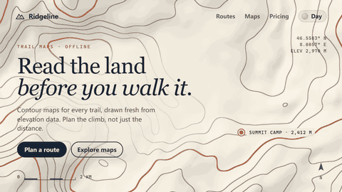</a>
      <br><b><a href="https://anticipate218.github.io/ai-native-effects/effects/topography.html">Topography Lines</a></b> · <code>&lt;ane-topography&gt;</code> · <sub>UI FX</sub>
      <br><sub>A living contour map for hero sections: crisp contour lines with index contours, elevation tints and hillshade. The pointer raises a hill, clicks send ripples, and themes cross-fade from light paper to night.</sub>
      <br><sub><a href="https://anticipate218.github.io/ai-native-effects/effects/topography.html">Playground</a> · <a href="docs/effects/topography.md">Docs</a> · <a href="src/effects/topography">Source</a></sub>
    </td>
    <td width="50%" valign="top">
      <a href="https://anticipate218.github.io/ai-native-effects/effects/orbit-gallery.html">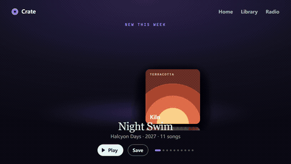</a>
      <br><b><a href="https://anticipate218.github.io/ai-native-effects/effects/orbit-gallery.html">Orbit Gallery</a></b> · <code>&lt;ane-orbit-gallery&gt;</code> · <sub>UI FX</sub>
      <br><sub>Real DOM cards on a tilted 3D ring: drag or fling with inertia and snap, click a side card to bring it round, arrow keys, autoplay and a floor reflection. Accessible carousel; any HTML inside.</sub>
      <br><sub><a href="https://anticipate218.github.io/ai-native-effects/effects/orbit-gallery.html">Playground</a> · <a href="docs/effects/orbit-gallery.md">Docs</a> · <a href="src/effects/orbit-gallery">Source</a></sub>
    </td>
  </tr>
</table>
<!-- effects:end -->

More effects are on the way. See the [roadmap](#roadmap).

## Quick start

### From a CDN (no build step)

```html
<script type="module" src="https://anticipate218.github.io/ai-native-effects/cdn/effects/thinking-buddy.js"></script>

<ane-thinking-buddy state="thinking"></ane-thinking-buddy>
```

### With npm

The package installs straight from GitHub (the library is built on install):

```bash
npm install github:anticipate218/ai-native-effects
```

```ts
import 'ai-native-effects/thinking-buddy'; // registers <ane-thinking-buddy>

const buddy = document.querySelector('ane-thinking-buddy')!;
buddy.state = 'thinking';
const result = await runAgent();
buddy.state = result.ok ? 'success' : 'error';
```

Import `ai-native-effects` to register every effect, or `ai-native-effects/<effect-id>` to ship only what you use.

### In your framework

<details>
<summary><b>React 19</b></summary>

```tsx
import 'ai-native-effects/thinking-buddy';

export function AgentStatus({ state }: { state: 'idle' | 'thinking' | 'waiting' | 'success' | 'error' }) {
  return <ane-thinking-buddy state={state} size="96px" />;
}
```

TypeScript users can declare the element once, as shown in the [component docs](docs/effects/thinking-buddy.md#typescript-and-react).

</details>

<details>
<summary><b>Vue 3</b></summary>

```vue
<script setup lang="ts">
import 'ai-native-effects/thinking-buddy';
defineProps<{ state: string }>();
</script>

<template>
  <ane-thinking-buddy :state="state" />
</template>
```

Tell the compiler about custom elements: `compilerOptions.isCustomElement = (tag) => tag.startsWith('ane-')`.

</details>

<details>
<summary><b>Svelte, Angular, plain HTML</b></summary>

Custom Elements work natively. In Angular, add `CUSTOM_ELEMENTS_SCHEMA` to the component that uses them.

</details>

## Design principles

| | |
| --- | --- |
| **Framework-agnostic** | Standard Custom Elements with attributes, properties and DOM events. Safe to import during SSR. |
| **Accessible** | Meaningful `role`/`aria-label`, optional polite live announcements, and a calm variant for `prefers-reduced-motion` (or force it with `motion="reduce"`). |
| **Light on the main thread** | Zero runtime dependencies. All effects share one `requestAnimationFrame` loop that stops when nothing is visible; each element pauses while off-screen. |
| **Tunable** | Colors, size and speed via attributes or CSS custom properties (`--ane-*`). |
| **Deterministic** | Seeded randomness and a virtual-time capture pipeline: previews and tests are reproducible frame by frame. |

Every effect passes the same quality gate before it ships: unit tests, axe-core WCAG 2.2 AA checks, a per-frame JS budget, 320 px mobile layout, reduced-motion behaviour and off-screen pausing. See [`tests/e2e/site.spec.ts`](tests/e2e/site.spec.ts).

## Development

```bash
npm install
npm run dev        # showcase site with hot reload: http://localhost:5173
npm run check      # typecheck + unit tests + build + e2e quality gate
npm run capture -- <id>   # re-record GIF / MP4 / poster previews (needs ffmpeg; --all for every effect)
npm run new -- my-effect --title "My Effect"   # scaffold a new effect
npm run sync       # regenerate README effect tables from effects.json
```

Project layout:

```
src/core/            shared ticker, base element, motion + math helpers
src/effects/<id>/    one folder per effect (component, tests, entry)
site/                showcase site: gallery, playgrounds, capture stage + scenes
scripts/             capture, screenshots, scaffolding, README sync
docs/                component docs (English) and docs/zh-CN (中文)
effects.json         effect manifest: gallery, READMEs, tests and builds read it
```

## Roadmap

- [x] **AI Thinking Buddy**: robot with idle / thinking / waiting / success / error states
- [x] **Agent Flow Visualizer**: live plan → tool call → result graph with expandable steps
- [x] **Liquid Glass Lens**: real glass refraction over live text; watch an assistant read and cite
- [x] **Aurora Curtain** (UI FX): a realistic northern-lights hero background
- [x] **Decrypt Text** (UI FX): jitter-free scramble-to-text with smooth morphs between strings
- [x] **Orbit Loading Screen**: a full WebGL loading screen where the planet sharpens tile by tile
- [x] **Image Reveal FX**: diffusion-style denoising reveal with a before/after compare slider
- [x] **Token Stream Text**: adaptive-paced streaming text with blur-to-sharp ink and a glowing caret
- [x] **Satellite Scan Reveal**: push-broom acquisition sweep plus an inference sweep that overlays a land-cover mask
- [ ] React and Vue typed wrappers

Ideas and votes are welcome in [issues](https://github.com/anticipate218/ai-native-effects/issues).

## Contributing

Contributions are welcome. Please read [CONTRIBUTING.md](CONTRIBUTING.md): it covers the effect checklist, the quality gate and the licensing rules (original work only; credit any inspiration in [docs/CREDITS.md](docs/CREDITS.md)).

## License

[MIT](LICENSE) © 2026 anticipate218
