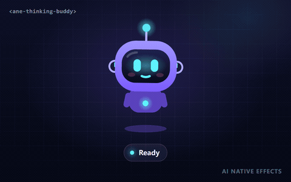
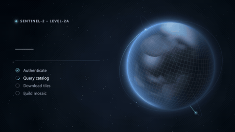
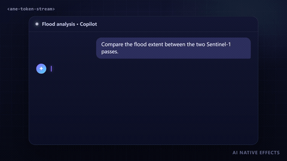
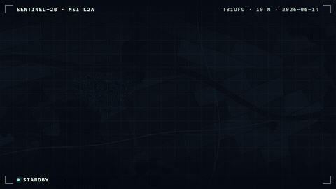

<div align="center">

<a href="https://anticipate218.github.io/ai-native-effects/"></a>

# AI Native Effects

**让 AI 看不见的工作被看见。**

一组带动画、可访问的 Web Components，把 AI 系统的执行状态（思考、规划、工具调用、加载、失败）变成清晰又生动的界面。

[**在线演示**](https://anticipate218.github.io/ai-native-effects/) · [交互调参](https://anticipate218.github.io/ai-native-effects/effects/thinking-buddy.html) · [组件文档](docs/zh-CN/effects/thinking-buddy.md) · [English](README.md)

</div>

> 英文文档是主入口，中文文档是补充。API 细节以 [README.md](README.md) 与 [docs/effects](docs/effects) 为准。

## 为什么要做「AI 原生动效」？

转圈的加载图标只能表达「有事在发生」。AI 产品需要表达的是**发生了什么**：模型在思考？在等工具返回？在等用户确认？已经完成，还是卡住了？这些状态是每个聊天助手和智能体的「心跳」，但大多数界面仍然只用同一个灰色 loader。

AI Native Effects 专门为这些时刻提供小而可用于生产的组件。每个组件都是标准的 Custom Element，可以直接用于 React、Vue、Svelte、Angular 或纯 HTML，并且都满足同一套无障碍、性能和移动端标准。

## 组件

<!-- effects:start -->
<table>
  <tr>
    <td width="50%" valign="top">
      <a href="https://anticipate218.github.io/ai-native-effects/effects/thinking-buddy.html"></a>
      <br><b><a href="https://anticipate218.github.io/ai-native-effects/effects/thinking-buddy.html">AI 思考小伙伴</a></b> · <code>&lt;ane-thinking-buddy&gt;</code> · <sub>AI Native</sub>
      <br><sub>一个会思考、等待、成功和失败的小机器人，用肢体语言把智能体的执行状态变得一眼可读。</sub>
      <br><sub><a href="https://anticipate218.github.io/ai-native-effects/effects/thinking-buddy.html">在线演示</a> · <a href="docs/zh-CN/effects/thinking-buddy.md">文档</a> · <a href="src/effects/thinking-buddy">源码</a></sub>
    </td>
    <td width="50%" valign="top">
      <a href="https://anticipate218.github.io/ai-native-effects/effects/orbit-loading-screen.html"></a>
      <br><b><a href="https://anticipate218.github.io/ai-native-effects/effects/orbit-loading-screen.html">轨道加载界面</a></b> · <code>&lt;ane-orbit-loading-screen&gt;</code> · <sub>AI Native</sub>
      <br><sub>面向数据密集型 AI 与遥感应用的完整加载界面：WebGL 星球随数据到达逐块变清晰，旁边的排版面板展示进度、步骤与实时信息。</sub>
      <br><sub><a href="https://anticipate218.github.io/ai-native-effects/effects/orbit-loading-screen.html">在线演示</a> · <a href="docs/zh-CN/effects/orbit-loading-screen.md">文档</a> · <a href="src/effects/orbit-loading-screen">源码</a></sub>
    </td>
  </tr>
  <tr>
    <td width="50%" valign="top">
      <a href="https://anticipate218.github.io/ai-native-effects/effects/token-stream.html"></a>
      <br><b><a href="https://anticipate218.github.io/ai-native-effects/effects/token-stream.html">流式文本</a></b> · <code>&lt;ane-token-stream&gt;</code> · <sub>AI Native</sub>
      <br><sub>让流式 LLM 回答平滑地「落墨」：突发的分块被自适应节奏释放，每个词从模糊中浮起、由强调色褪为正文色，前方有发光的光标。</sub>
      <br><sub><a href="https://anticipate218.github.io/ai-native-effects/effects/token-stream.html">在线演示</a> · <a href="docs/zh-CN/effects/token-stream.md">文档</a> · <a href="src/effects/token-stream">源码</a></sub>
    </td>
    <td width="50%" valign="top">
      <a href="https://anticipate218.github.io/ai-native-effects/effects/scan-reveal.html"></a>
      <br><b><a href="https://anticipate218.github.io/ai-native-effects/effects/scan-reveal.html">卫星扫描揭示</a></b> · <code>&lt;ane-scan-reveal&gt;</code> · <sub>Remote sensing × AI</sub>
      <br><sub>推扫式卫星扫描线揭示影像，随后虚线推理扫描把地物分类掩膜叠加上去；可使用自己的影像与掩膜，也可使用程序化生成的场景。</sub>
      <br><sub><a href="https://anticipate218.github.io/ai-native-effects/effects/scan-reveal.html">在线演示</a> · <a href="docs/zh-CN/effects/scan-reveal.md">文档</a> · <a href="src/effects/scan-reveal">源码</a></sub>
    </td>
  </tr>
  <tr>
    <td width="50%" valign="top">
      <a href="https://anticipate218.github.io/ai-native-effects/effects/agent-flow.html"></a>
      <br><b><a href="https://anticipate218.github.io/ai-native-effects/effects/agent-flow.html">智能体流程可视化</a></b> · <code>&lt;ane-agent-flow&gt;</code> · <sub>AI Native</sub>
      <br><sub>把智能体的执行过程实时画成一张会生长的流程图：规划、并行工具调用、汇合与回答随事件出现，运行中的连线流动，完成后显示耗时，步骤可展开查看结果。</sub>
      <br><sub><a href="https://anticipate218.github.io/ai-native-effects/effects/agent-flow.html">在线演示</a> · <a href="docs/zh-CN/effects/agent-flow.md">文档</a> · <a href="src/effects/agent-flow">源码</a></sub>
    </td>
    <td width="50%"></td>
  </tr>
</table>
<!-- effects:end -->

## 快速开始

### 通过 CDN（无需构建）

```html
<script type="module" src="https://anticipate218.github.io/ai-native-effects/cdn/effects/thinking-buddy.js"></script>

<ane-thinking-buddy state="thinking"></ane-thinking-buddy>
```

### 通过 npm

直接从 GitHub 安装（安装时会自动构建）：

```bash
npm install github:anticipate218/ai-native-effects
```

```ts
import 'ai-native-effects/thinking-buddy'; // 注册 <ane-thinking-buddy>

const buddy = document.querySelector('ane-thinking-buddy')!;
buddy.labels = { thinking: '正在思考', success: '已完成' }; // 中文无障碍标签
buddy.state = 'thinking';
const result = await runAgent();
buddy.state = result.ok ? 'success' : 'error';
```

React、Vue 等框架的用法见 [英文 README](README.md#in-your-framework) 与 [组件文档](docs/zh-CN/effects/thinking-buddy.md)。

## 设计原则

- **框架无关**：标准 Custom Elements，支持属性、JS 属性与 DOM 事件；SSR 环境下导入也安全。
- **无障碍**：有意义的 `role` / `aria-label`，可选的状态播报（live region），遵循 `prefers-reduced-motion` 的低动效版本。
- **轻量高效**：零运行时依赖；所有组件共享一个 `requestAnimationFrame` 循环，离开视口自动暂停。
- **可调节**：颜色、尺寸、速度均可通过属性或 CSS 变量（`--ane-*`）配置。
- **可复现**：随机数可设种子，预览录制使用虚拟时钟，逐帧可复现。

每个组件发布前都要通过同一套质量门禁：单元测试、axe-core WCAG 2.2 AA 检查、每帧 JS 耗时预算、320px 移动端布局、低动效模式与离屏暂停。

## 开发

```bash
npm install
npm run dev        # 启动展示站点
npm run check      # 类型检查 + 单元测试 + 构建 + 端到端质量门禁
npm run capture    # 重新录制 GIF / MP4 / 封面（需要 ffmpeg）
npm run new -- my-effect --title "My Effect"   # 生成新组件脚手架
npm run sync       # 根据 effects.json 更新 README 组件表格
```

## 路线图

- [x] **AI 思考小伙伴**：空闲 / 思考 / 等待 / 成功 / 失败
- [x] **智能体流程可视化**：实时呈现规划、工具调用与结果，步骤可展开
- [x] **轨道加载界面**：完整的 WebGL 加载界面，星球随下载逐块变清晰
- [ ] **Image Reveal FX**：类扩散模型的影像前后对比揭示
- [x] **流式文本**：自适应节奏的流式文字，模糊到清晰的落墨效果与发光光标
- [x] **卫星扫描揭示**：推扫式获取扫描 + 叠加地物分类掩膜的推理扫描

欢迎在 [Issues](https://github.com/anticipate218/ai-native-effects/issues) 提出想法或投票。

## 贡献与许可

贡献前请阅读 [CONTRIBUTING.md](CONTRIBUTING.md)。只接受原创实现；参考了第三方作品时须在 [docs/CREDITS.md](docs/CREDITS.md) 中注明出处与许可证。

[MIT](LICENSE) © 2026 anticipate218
