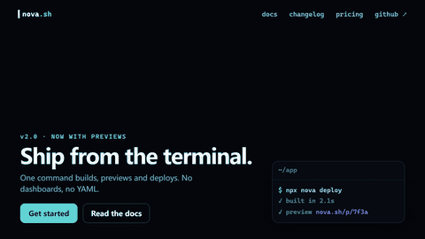

# ASCII Field · `<ane-ascii-field>`



A flowing field of **ASCII characters**, rendered by a fragment shader. Each cell's brightness picks its glyph from a ramp (`' .:-=+*#%@'` by default), the characters can **gather into a word** or an image and dissolve again, they **brighten under the pointer**, and a click sends a **shock wave** through the field. Put your own content inside to layer it on top, which makes it a ready-made hero background.

**[Open the playground →](https://anticipate218.github.io/ai-native-effects/effects/ascii-field.html)** · [中文文档](../zh-CN/effects/ascii-field.md)

## Install

```html
<!-- CDN, no build step -->
<script type="module" src="https://anticipate218.github.io/ai-native-effects/cdn/effects/ascii-field.js"></script>
```

```bash
npm install github:anticipate218/ai-native-effects
```

```ts
import 'ai-native-effects/ascii-field';
```

## Usage

```html
<ane-ascii-field text="HELLO" text-y="0.4" style="min-height:480px;background:#05070c">
  <h1>Your hero, on top of the field.</h1>
</ane-ascii-field>
```

```ts
const field = document.querySelector('ane-ascii-field')!;
await field.morph('SHIP');   // dissolve, then gather into a new word
field.shockwave();           // ripple from the centre
await field.dissolve();      // melt back into the field
```

The element is transparent: give it (or its container) a dark background. It fills its container's width and is at least `260px` tall (`size` or `min-height` to change).

## API

| Attribute | Values | Default | Description |
| --- | --- | --- | --- |
| `charset` | `classic` `blocks` `binary` `dots` `lines` `katakana`, or any ramp string (dark → bright) | `classic` | Glyphs. |
| `cell` | `6`–`40` | `13` | Glyph size in CSS px. |
| `color`, `accent` | hex colours | `#4de2c5`, `#8f7bff` | Gradient across the field. |
| `text` | string (`\n` for a new line) | none | Word the characters gather into. |
| `reveal` | `0`–`1` | `1` | How strongly the word (or image) shows. |
| `text-y` | `0`–`1` | `0.5` | Vertical position of the word. |
| `src` | image URL | none | Image used as the mask instead of text (same-origin or CORS-enabled). |
| `contrast` | `0.4`–`2` | `1` | Field contrast. |
| `scale` | `0.3`–`4` | `1` | Size of the flow features. |
| `interactive` | `on` `off` | `on` | Pointer lens and click shock waves. |
| `quality` | `0.4`–`1` | `1` | Render scale; steps down automatically on slow devices. |
| `seed`, `speed`, `motion`, `size` | | `7`, `1`, `auto`, `260px` | Pattern seed, time scale, reduced motion, minimum height. |

| Member | Description |
| --- | --- |
| `morph(text, ms = 1600)` | Dissolves the current word and gathers the characters into `text`. Returns a Promise. |
| `dissolve(ms = 1200)` | Lets the word melt back into the field (the `text` attribute is kept). |
| `shockwave(x?, y?)` | Sends a wave from a point (element coordinates; default centre). Clicks do this too. |
| `webgl`, `renderScale`, `time` | Whether WebGL2 runs; the current render scale; field time in seconds. |
| `::part(content)` | The layer that holds your content. |

## How it works

- **Shader.** Every pixel finds its character cell and evaluates a domain-warped fbm noise field at the cell centre; the word mask, the pointer lens and click waves are added on top. The value picks a glyph from the ramp.
- **Crisp glyphs.** The glyph atlas is redrawn whenever the cell size changes, at exactly the cell size in device pixels, and sampled texel by texel (`texelFetch`), so characters never blur.
- **Words and images.** Text (or an image's luminance) is drawn at screen proportions and scaled down to one pixel per cell, giving an anti-aliased mask; `reveal` blends field and mask.
- **Budget.** JavaScript only sets uniforms each frame. The canvas uses at most 1.5 device pixels per CSS pixel and 1.4 MP; software rasterisers start at half resolution, and slow frames step the resolution down.

## Accessibility and performance

- The canvas is decorative (`aria-hidden`). When `text` is set, it is also exposed as visually hidden text. Your slotted content stays real, selectable, clickable HTML.
- Reduced motion: the field is frozen in a single frame, there are no shock waves, and words switch instantly.
- Without WebGL2 the field stays empty and your content still shows. The loop pauses off-screen.
