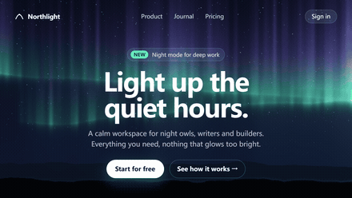

# Aurora Curtain · `<ane-aurora>`



A hero background that feels like standing under the northern lights. Curtains of light hang from bright lower hems, vertical rays rise and fade from green into violet, folds drift with the wind and lean towards the pointer, and stars twinkle above a mountain horizon. Wrap your hero in one tag: the content stays plain, accessible HTML on top.

**[Open the playground →](https://anticipate218.github.io/ai-native-effects/effects/aurora.html)** · [中文文档](../zh-CN/effects/aurora.md)

## Install

```html
<!-- CDN, no build step -->
<script type="module" src="https://anticipate218.github.io/ai-native-effects/cdn/effects/aurora.js"></script>
```

```bash
npm install github:anticipate218/ai-native-effects
```

```ts
import 'ai-native-effects/aurora';
```

## Usage

```html
<ane-aurora interactive palette="borealis" style="min-height: 100vh">
  <nav>…</nav>
  <h1>Light up the quiet hours.</h1>
  <a class="cta" href="/signup">Start for free</a>
</ane-aurora>
```

Pick a preset (`borealis`, `dusk`, `glacier`, `ember`) or set your own colours with `color` (the hem) and `accent` (the crown).

## API

| Attribute | Values | Default | Description |
| --- | --- | --- | --- |
| `palette` | `borealis` `dusk` `glacier` `ember` | `borealis` | Colour preset (hem, crown, sky). |
| `color`, `accent` | hex or `rgb()` | palette | Hem (low) and crown (high) colours. |
| `intensity` | `0`–`2` | `1` | Brightness of the curtains. |
| `rays` | `0`–`1` | `0.8` | Contrast of the vertical rays. |
| `stars` | `0`–`2` | `1` | Star density. |
| `horizon` | `0`–`1` | `1` | Mountain ridges (`0` hides them). |
| `grain` | `0`–`1` | `0.22` | Film-grain overlay. |
| `interactive` | boolean | off | Curtains dip and brighten near the pointer (touch: on tap). |
| `quality` | `0.25`–`1` | `0.75` | Render scale. The aurora is soft, so lower values stay pretty and save GPU time; the grain overlay stays crisp. |
| `seed` | number | `7` | Shape of the curtains and ridges. |
| `size` | CSS length | `520px` | Minimum height (`--ane-size`); the element is always full width. |
| `speed`, `motion` | | `1`, `auto` | Time scale; reduced motion shows a still frame. |

Property: `webgl` (`false` when the CSS gradient fallback is used). Part: `::part(content)`.

## How it works

One full-screen fragment shader (WebGL2):

- **Curtains.** Three curtains, each with a lower hem drawn from a sine plus fractal noise that drift slowly. Above the hem, light decays exponentially with height, with a sharp falloff below and a thin hot edge at the hem.
- **Rays and folds.** High-frequency noise stretched vertically carves rays that slide sideways. A slow fractal-noise envelope along each curtain switches stretches on and off, giving folds and gaps.
- **Colour.** Colour shifts from the hem hue to the crown hue with altitude. A soft bloom lights the sky, stars fade where the aurora is bright, and a filmic shoulder rolls off highlights.
- **Horizon.** Two fractal-noise ridges, the near one rim-lit by the aurora.
- **Grain** is an SVG-noise CSS overlay, so it stays sharp at any render scale.

## Accessibility and performance

- The canvas and grain are decorative (`aria-hidden`); your slotted content is untouched DOM, readable and clickable. Check your text contrast over the brightest curtains (white text works well with the presets).
- Reduced motion renders a still frame and ignores the pointer.
- One draw call per frame at 75% resolution by default; the loop pauses off-screen and the WebGL context is released when the element is removed. Without WebGL2 a CSS gradient fallback is shown.
