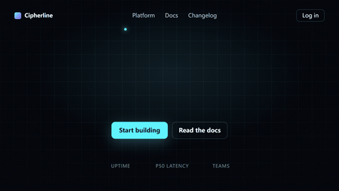

# Decrypt Text · `<ane-decrypt-text>`



Headlines, labels and numbers that decode themselves out of scrambled glyphs. Unlike most scramble effects, **the line never jitters**: every character cell keeps the width of its final glyph, and scrambles only through glyphs of a similar width in your actual font. Change the text and it **morphs** from the old string to the new one, opening and closing cells smoothly. Chinese, Japanese and Korean positions scramble through their own glyphs.

**[Open the playground →](https://anticipate218.github.io/ai-native-effects/effects/decrypt-text.html)** · [中文文档](../zh-CN/effects/decrypt-text.md)

## Install

```html
<!-- CDN, no build step -->
<script type="module" src="https://anticipate218.github.io/ai-native-effects/cdn/effects/decrypt-text.js"></script>
```

```bash
npm install github:anticipate218/ai-native-effects
```

```ts
import 'ai-native-effects/decrypt-text';
```

## Usage

```html
<h1>
  <ane-decrypt-text>Interfaces that</ane-decrypt-text>
  <ane-decrypt-text id="word" stagger="300">remember.</ane-decrypt-text>
</h1>
<span class="stat"><ane-decrypt-text charset="digits" scramble="800">99.98%</ane-decrypt-text></span>
<a href="/docs"><ane-decrypt-text trigger="hover" charset="symbols">Read the docs</ane-decrypt-text></a>
```

```ts
const word = document.querySelector('#word')!;
const words = ['remember.', 'react.', 'feel alive.'];
let i = 0;
setInterval(() => (word.text = words[++i % words.length]), 3000); // morphs each time
```

The element is inline, so it inherits your font, size, colour and even `background-clip: text` gradients from its parent.

## API

| Attribute | Values | Default | Description |
| --- | --- | --- | --- |
| `text` | string | text content | The text; changing it morphs from the current text. |
| `trigger` | `view` `hover` `manual` | `view` | Decode once when scrolled into view; also on hover and focus; or only via `decode()`. |
| `order` | `ltr` `rtl` `center` `random` | `ltr` | Order in which characters lock. |
| `charset` | `latin` `upper` `hex` `binary` `digits` `blocks` `symbols` `katakana`, or any glyph string | `latin` | Scramble glyphs. `latin` keeps case and digits; CJK positions always use CJK glyphs. |
| `stagger` | ms | `600` | Spread of reveal start times across the text. |
| `scramble` | ms | `450` | Scramble time per character. |
| `accent` | any CSS color | `#5ef2ff` | Colour of scrambling glyphs and the lock flash. |
| `glow` | `0`–`2` | `1` | Strength of the lock-flash glow. |
| `seed` | integer | `7` | Deterministic glyphs and random order. |
| `size`, `speed`, `motion` | | inherit, `1`, `auto` | Font size, time scale, reduced motion. |

| Member | Description |
| --- | --- |
| `decode()` | Plays the decode again. |
| `text` | Get or set the text (setting morphs). |
| `decoding` | `true` while scrambling. |
| `ane-decrypt-done` | Fired when the text has fully decoded (`{ text }`). |
| `::part(text)`, `--ane-decrypt-accent`, `--ane-decrypt-glow` | Styling hooks. |

## How it works

- **Cells.** Each grapheme becomes a cell holding the final glyph (invisible while scrambling, so it sets the width) and an absolutely positioned scramble glyph. Words are wrapped as units, so lines only break between words.
- **Width-matched glyphs.** Every glyph of the pool is measured once in the element's font (canvas `measureText`, cached per font), and each cell scrambles only through glyphs within ±25% of its final glyph's width (or the six closest).
- **Timing.** Each cell gets a start and lock time from the reveal order and `stagger`. Glyphs change every 55 ms from a hash of position, time slice and seed, so recordings are reproducible.
- **Morph.** Cells that disappear keep the old glyph as an invisible spacer and close after they lock; new cells open from zero width.

## Accessibility and performance

- Assistive technology gets the final text immediately: the host has `role="text"` and an `aria-label`, and the visual cells are `aria-hidden`. Screen readers never hear the scramble.
- Reduced motion: no scrambling. The final text fades in, and morphs swap instantly.
- DOM only, no canvas rendering. Each frame updates only the cells whose glyph or state changed; the loop pauses off-screen.
