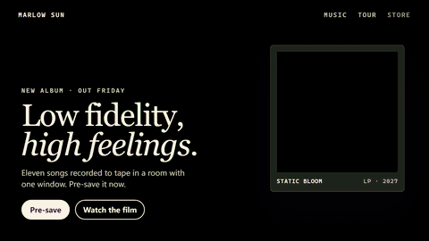

# Dither Gradient · `<ane-dither-gradient>`



A flowing gradient, or any image, rendered through a **limited palette** with **ordered (Bayer) or noise dithering**, the look of print, risograph or an old handheld screen. Move the pointer and a **lens** shows the smooth, undithered colours underneath. Put your own content inside to layer it on top; switch the palette to go from a dusk hero to a light, printed page.

**[Open the playground →](https://anticipate218.github.io/ai-native-effects/effects/dither-gradient.html)** · [中文文档](../zh-CN/effects/dither-gradient.md)

## Install

```html
<!-- CDN, no build step -->
<script type="module" src="https://anticipate218.github.io/ai-native-effects/cdn/effects/dither-gradient.js"></script>
```

```bash
npm install github:anticipate218/ai-native-effects
```

```ts
import 'ai-native-effects/dither-gradient';
```

## Usage

```html
<ane-dither-gradient palette="sunset" style="min-height:480px">
  <h1>Low fidelity, high feelings.</h1>
</ane-dither-gradient>

<!-- a light, printed look -->
<ane-dither-gradient colors="#b9a68a,#ddd0b8,#f3ecdc,#fffaf0" palette="paper"></ane-dither-gradient>

<!-- dither a photo instead of the gradient -->
<ane-dither-gradient src="/poster.jpg" palette="mono" pixel="2"></ane-dither-gradient>
```

The element fills its container's width and is at least `260px` tall (`size` or `min-height` to change). Without WebGL2 it shows a plain CSS gradient of the same colours.

## API

| Attribute | Values | Default | Description |
| --- | --- | --- | --- |
| `colors` | 2–6 hex colours | dusk | Gradient stops. |
| `palette` | `auto` `sunset` `paper` `gameboy` `mono` `cga` `ocean`, or 2–8 hex colours | `auto` | Colours the output is snapped to; `auto` uses the gradient stops. |
| `pixel` | `1`–`16` | `3` | Pixel size in CSS px. |
| `dither` | `bayer8` `bayer4` `noise` | `bayer8` | Threshold pattern: classic 8×8 / chunky 4×4 ordered dithering, or an interleaved-gradient noise. |
| `spread` | `0`–`2` | `1` | Dither strength (`0` = hard posterised bands). |
| `scale` | `0.3`–`4` | `1` | Size of the flow features. |
| `lens`, `lens-size` | `on` `off`, CSS px | `on`, `90` | Smooth-colour lens under the pointer. |
| `src` | image URL | none | Dither an image instead of the gradient (same-origin or CORS-enabled). |
| `quality` | `0.4`–`1` | `1` | Render scale; steps down automatically on slow devices. |
| `seed`, `speed`, `motion`, `size` | | `7`, `1`, `auto`, `260px` | Pattern seed, time scale, reduced motion, minimum height. |

| Member | Description |
| --- | --- |
| `stops`, `palette` | The gradient stops and palette in use (0–1 RGB). |
| `webgl`, `renderScale`, `time` | Whether WebGL2 runs; current render scale; gradient time in seconds. |
| `::part(content)` | The layer that holds your content. |

## How it works

- **One shader pass.** Each pixel cell samples the source (a domain-warped noise field mapped through the gradient stops, or the image with `object-fit: cover`), adds a threshold from the dither pattern scaled by `spread / (palette size − 1)`, and snaps to the nearest palette colour (luma-weighted distance).
- **Bayer matrices** come from bit interleaving (`bayer4`/`bayer8` are exported and unit-tested to contain every threshold exactly once).
- **Lens.** Inside the lens the source is sampled per screen pixel without dithering, so you see the smooth "negative"; outside, only one sample per cell is taken.
- **Budget.** JavaScript only sets uniforms. The canvas uses at most 1.5 device pixels per CSS pixel and 1.4 MP; software rasterisers start at half resolution, and slow frames step the resolution down.

## Accessibility and performance

- The canvas is decorative (`aria-hidden`); your slotted content stays real HTML. Check the contrast of your text against the palette you pick (for light palettes, a soft paper-coloured glow behind body copy helps, as in the demo).
- Reduced motion: the gradient stays still; the lens still works.
- The loop pauses off-screen.
