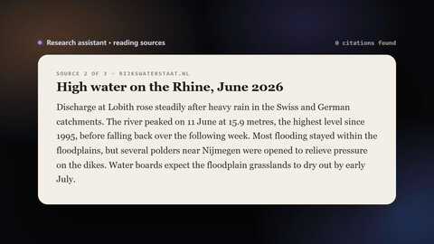

# Liquid Glass Lens · `<ane-glass-lens>`



A liquid-glass lens that refracts the **live** content it wraps: text stays selectable, links stay clickable. It has three modes:
- **`read`**: shows an assistant reading a source. The lens glides along the text line by line, magnifies what it passes, dwells on the passages it cites and leaves them highlighted. It's useful in RAG, research and citation UIs, where "reading 3 sources…" is otherwise just a spinner.
- **`follow`**: the lens tracks the pointer on desktop and is placed by a tap on touch screens.
- **`static`**: you position it from code.

**[Open the playground →](https://anticipate218.github.io/ai-native-effects/effects/glass-lens.html)** · [中文文档](../zh-CN/effects/glass-lens.md)

## Install

```html
<!-- CDN, no build step -->
<script type="module" src="https://anticipate218.github.io/ai-native-effects/cdn/effects/glass-lens.js"></script>
```

```bash
npm install github:anticipate218/ai-native-effects
```

```ts
import 'ai-native-effects/glass-lens';
```

## Usage

Wrap the passage the assistant is reading and mark its citations:

```html
<ane-glass-lens mode="read" rate="320">
  <article>
    <p>Discharge rose after heavy rain. <mark>The river peaked on 11 June at 15.9 metres</mark>, …</p>
  </article>
</ane-glass-lens>
```

```ts
const lens = document.querySelector('ane-glass-lens')!;
lens.addEventListener('ane-lens-mark', (e) => showCitation(e.detail.element));
lens.addEventListener('ane-lens-done', (e) => console.log(e.detail.found, 'citations'));
lens.read(); // start (again)
```

A glass magnifier anywhere:

```html
<ane-glass-lens mode="follow" strength="0.6" dispersion="0.5">
  
</ane-glass-lens>
```

Give the wrapped content its own background (a card or an image). The lens refracts what is *inside* the element, not the page behind it.

## API

| Attribute | Values | Default | Description |
| --- | --- | --- | --- |
| `mode` | `read` `follow` `static` | `follow` | Reading pass, pointer/touch tracking, or positioned with `focusOn()`. |
| `marks` | CSS selector | `mark, [data-lens-mark]` | Passages the reader dwells on and highlights. |
| `rate` | px/s | `320` | Reading speed. |
| `loop` | boolean | off | Read again after a pause. |
| `strength` | `0`–`1` | `0.5` | Refraction strength. |
| `dispersion` | `0`–`1` | `0.4` | Chromatic (RGB) split. |
| `curvature` | `0`–`1` | `0.55` | Body magnification. |
| `bend` | `0`–`1` | `0.45` | Rim bend: content just outside bends into the edge. |
| `lens-width`, `lens-height` | px | auto | Lens size; in read mode the height follows the line height. |
| `accent` | any CSS color | `#7c5cff` | Highlight colour (`--ane-lens-accent`). |
| `announce` | boolean | off | Announces found passages in a polite live region. |
| `speed`, `motion` | | `1`, `auto` | Time scale; reduced motion. |

| Member | Description |
| --- | --- |
| `read()`, `stop()` | Start a reading pass; stop and hide the lens (highlights stay). |
| `focusOn(element)` | Move the lens over an element of the content. |
| `found` | Elements highlighted in the current pass. |
| `ane-lens-mark` | `{ index, element }` when a passage is reached. |
| `ane-lens-done` | `{ found }` at the end of a pass. |
| `::part(lens)`, `::part(content)` | Styling hooks. |

## How it works

- **Optics.** For each lens shape, a displacement map is computed in TypeScript from a rounded-rectangle signed distance field:
  - R and G hold the x/y offset;
  - B holds the specular rim.
  The body samples towards the centre (magnification); a thin rim band samples just outside the lens, so nearby content bends into the edge like a liquid lip. The map is rebuilt only when the size changes; moving the lens only moves the map.
- **Rendering.** An SVG filter on the wrapped content (`filter: url()`, which works in Chromium, Firefox and Safari, unlike `backdrop-filter: url()`):
  - displaces the content three times at slightly different scales for the RGB dispersion;
  - recombines the channels and restores the original alpha;
  - limits the effect to the lens shape, leaving everything else pixel-identical;
  - adds the specular rim.
  A DOM ring on top gives the lens its edge and shadow.
- **Reading.** Line boxes come from `Range.getClientRects()` over the text. The lens sweeps each line and dwells on the first line fragment of each citation (so wrapped citations work), then highlights each of the citation's line fragments.

## Accessibility

- The content is untouched DOM: selectable, searchable, read normally by screen readers. The lens and highlights are decorative; add `announce` to hear found passages.
- Reduced motion: no gliding. Citations are highlighted one after another and the lens rests on each.
- On touch screens a tap places the lens (there is no hover).

## Performance

- The displacement map (a few thousand pixels) is regenerated only on shape changes; per frame the component updates a handful of attributes.
- SVG filters run on the GPU in Chromium. Keep lenses content-sized; one lens per card is the intended use. The loop pauses off-screen.
