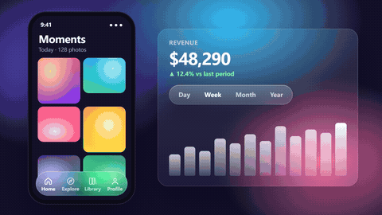

# Glass Tabs · `<ane-glass-tabs>`



A tab bar whose selected tab sits under a **liquid-glass lens**. The lens **really refracts and magnifies** the icons and labels beneath it, with a little chromatic dispersion. Switching tabs, it **slides on a spring** and **stretches with its speed** like a drop of liquid, then settles. You can also **drag the lens** to scrub between tabs. It is a proper tablist: roving tab index, arrow keys, `aria-selected` and a change event. Your tabs stay your own buttons.

**[Open the playground →](https://anticipate218.github.io/ai-native-effects/effects/glass-tabs.html)** · [中文文档](../zh-CN/effects/glass-tabs.md)

## Install

```html
<!-- CDN, no build step -->
<script type="module" src="https://anticipate218.github.io/ai-native-effects/cdn/effects/glass-tabs.js"></script>
```

```bash
npm install github:anticipate218/ai-native-effects
```

```ts
import 'ai-native-effects/glass-tabs';
```

## Usage

```html
<!-- segmented control -->
<ane-glass-tabs selected="1" aria-label="Time range">
  <button>Day</button>
  <button>Week</button>
  <button>Month</button>
  <button>Year</button>
</ane-glass-tabs>

<!-- app tab bar: any content inside the buttons -->
<ane-glass-tabs aria-label="Sections" style="width:320px">
  <button><svg>…</svg><span>Home</span></button>
  <button><svg>…</svg><span>Explore</span></button>
  <button><svg>…</svg><span>Library</span></button>
</ane-glass-tabs>
```

```ts
const tabs = document.querySelector('ane-glass-tabs')!;
tabs.addEventListener('ane-tab-change', (e) => showPanel(e.detail.index));
tabs.selected = 2; // from code (no event): the lens slides there
```

The element sets `role="tablist"` on itself and `role="tab"`, `aria-selected` and a roving `tabindex` on the tabs. Wire `aria-controls` / `aria-labelledby` to your panels as usual. Tabs share the width equally; it looks best over a colourful background, since the bar itself is frosted glass.

## API

| Attribute | Values | Default | Description |
| --- | --- | --- | --- |
| `selected` | index | `0` | Selected tab; user changes are reflected here. |
| `accent` | CSS colour | `#fff` | Selected label and focus ring. |
| `tint` | CSS colour | white at 10% | Lens tint. |
| `strength` | `0`–`1` | `0.6` | Refraction strength. |
| `curvature` | `0`–`1` | `0.85` | Magnification of the glass dome. |
| `dispersion` | `0`–`1` | `0.35` | Chromatic fringes at the glass edge. |
| `stretch` | `0`–`1` | `0.8` | Liquid stretch while the lens moves. |
| `speed`, `motion` | | `1`, `auto` | Time scale, reduced motion. |

| Member | Description |
| --- | --- |
| `selected` | Get or set the selected index (setting from code does not fire the event). |
| `tabs` | The slotted tabs. |
| `ane-tab-change` | Fired when the user changes the tab by click, keyboard or drag (`{ index, tab }`). |
| `::part(bar)`, `::part(lens)`, `::part(content)`, `--ane-glass-pad`, `--ane-glass-gap`, `--ane-glass-accent`, `--ane-glass-tint` | Styling hooks. |

## How it works

- **Refraction.** The tabs are filtered by an SVG `feDisplacementMap` whose map is a rounded-rectangle glass profile (the signed-distance optics shared with `<ane-glass-lens>`): a dome that magnifies, plus a strong bend at the rim. Three displacement passes with slightly different scales give the colour fringes.
- **Cheap motion.** One map is generated per tab size and cached. While the lens moves, the map is only repositioned and stretched (`feImage` x/y/width/height), never rebuilt per frame.
- **Liquid feel.** Position and width run on springs. The lens grows along its velocity and thins across it (`liquidStretch`), and it stays inside the bar at both ends. While dragging, a stiffer spring follows the pointer; on release, it snaps to the nearest tab.

## Accessibility and performance

- ARIA tabs pattern with automatic activation: arrow keys (wrapping), Home and End move focus and selection together. The focus ring uses the accent colour.
- Touch: drag along the bar to scrub; vertical page scrolling still works (`touch-action: pan-y`).
- Reduced motion: the lens jumps to the new tab without sliding or stretching.
- DOM, CSS and one SVG filter; when the lens is at rest, nothing is written per frame. The loop pauses off-screen.
