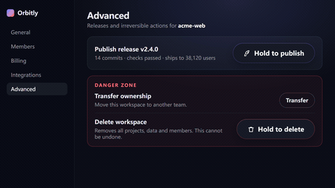

# Hold to Confirm · `<ane-hold-button>`



**Press and hold to confirm.** A replacement for "Are you sure?" dialogs on irreversible actions. While held, a **liquid fill with a rippling front** advances, the button **squishes** slightly and its **glow builds**, with a little **shake** near the end. Release early and the fill **drains back**. Hold to the end for a **drawn check mark**, a **burst** and an optional haptic tap. Works with mouse, touch and keyboard (hold Space or Enter).

**[Open the playground →](https://anticipate218.github.io/ai-native-effects/effects/hold-button.html)** · [中文文档](../zh-CN/effects/hold-button.md)

## Install

```html
<!-- CDN, no build step -->
<script type="module" src="https://anticipate218.github.io/ai-native-effects/cdn/effects/hold-button.js"></script>
```

```bash
npm install github:anticipate218/ai-native-effects
```

```ts
import 'ai-native-effects/hold-button';
```

## Usage

```html
<ane-hold-button done-text="Deleted">Hold to delete</ane-hold-button>
<ane-hold-button color="#7c6cff" duration="1200" done-text="Published">
  <svg><!-- icon --></svg> Hold to publish
</ane-hold-button>
```

```ts
const btn = document.querySelector('ane-hold-button')!;
btn.addEventListener('ane-hold-complete', () => deleteWorkspace());
btn.addEventListener('ane-hold-cancel', (e) => console.log('released at', e.detail.progress));
btn.reset(); // back to the start (e.g. if the request failed)
```

The label is whatever you put inside (text and icons). The button is self-contained, with a dark pill style; use `--ane-hold-bg` and `--ane-hold-fg` to theme it for light pages.

## API

| Attribute | Values | Default | Description |
| --- | --- | --- | --- |
| `duration` | ms | `1500` | How long to hold. |
| `color` | CSS colour | `#ff4d5e` | Fill while holding. |
| `accent` | CSS colour | `#2fd39a` | Colour once confirmed. |
| `done-text` | string | `Done` | Label after confirming (also announced to screen readers). |
| `reset-after` | ms | `2400` | Time before it resets; `0` keeps it confirmed. |
| `haptics` | `on` `off` | `on` | Vibrate on completion where the browser supports it. |
| `disabled` | boolean | off | Not interactive (`aria-disabled`). |
| `size`, `speed`, `motion` | | `48px`, `1`, `auto` | Height, time scale, reduced motion. |

| Member | Description |
| --- | --- |
| `ane-hold-start` | The hold began. |
| `ane-hold-cancel` | Released before the end (`detail.progress`). |
| `ane-hold-complete` | Confirmed. |
| `progress`, `confirmed`, `reset()` | Progress 0–1; whether confirmed; back to the start. |
| `::part(button)`, `::part(fill)`, `::part(label)`, `::part(done)`, `--ane-hold-color`, `--ane-hold-accent`, `--ane-hold-bg`, `--ane-hold-fg` | Styling hooks. |

## How it works

- **Fill.** A layer behind the label is clipped by a polygon whose front ripples with a sine wave, damped at the very start and end (`waveFront`). It advances linearly while held and drains back at 2.5× speed when released.
- **Feel.** A short squish on press (spring-damped), a glow tied to progress (`--p`), a shake that only starts after 60% and grows towards the end (`anticipation`), and a small pop on completion.
- **Completion.** The label slides out, a check mark draws itself (stroke-dashoffset), particles burst from the outline on a canvas and the colour switches to `accent`.

## Accessibility and performance

- `role="button"`, focusable, with `aria-description="Press and hold to confirm"`. Holding Space or Enter works like holding the pointer (auto-repeat is ignored). Losing focus or the pointer cancels the hold. The confirmed text is announced through a live region.
- Touch: the long-press context menu is suppressed, and the fill follows your finger's hold.
- Reduced motion: the fill still shows progress (it is the feedback), but there is no shake, no pop and no burst; the check appears at once.
- DOM, CSS and a small canvas for the burst; the canvas is cleared when idle, and nothing runs while the button rests.
