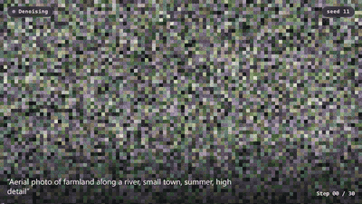

# Image Reveal FX · `<ane-image-reveal>`



TODO: one-paragraph pitch. What AI product moment does this effect make legible?

**[Open the playground →](https://anticipate218.github.io/ai-native-effects/effects/image-reveal.html)** · [中文文档](../zh-CN/effects/image-reveal.md)

## When to use it

- TODO

## Install

```html
<script type="module" src="https://anticipate218.github.io/ai-native-effects/cdn/effects/image-reveal.js"></script>
<ane-image-reveal></ane-image-reveal>
```

```ts
import 'ai-native-effects/image-reveal';
```

## API

| Attribute | Values | Default | Description |
| --- | --- | --- | --- |
| `color` | any CSS color | `#7c5cff` | Primary color. |
| `accent` | any CSS color | `#5ef2ff` | Secondary color. |
| `size` | CSS length | `240px` | Width and height. |
| `speed` | `0`–`5` | `1` | Animation time scale. |
| `motion` | `auto` `reduce` `full` | `auto` | `auto` follows `prefers-reduced-motion`. |
| `label` | string | `Image Reveal FX` | Accessible label. |

## Accessibility

- TODO: role and label, what the reduced-motion variant shows.

## Performance

- TODO: rendering approach and per-frame cost.
