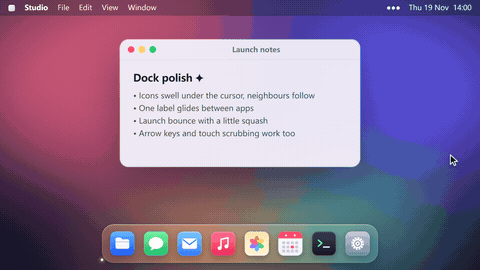

# Magnetic Dock · `<ane-magnet-dock>`



A dock for any buttons or links. Icons **swell under the pointer on springs** with a little overshoot, neighbours follow on a smooth falloff and **lean towards the pointer**, one **shared label glides** between apps (resizing as it goes), and a launch **bounces with squash and stretch**. It is a real toolbar: arrow keys move focus and magnify the focused icon, and on touch you can scrub along the dock. Narrow screens shrink the icons so the dock never forces horizontal scrolling.

**[Open the playground →](https://anticipate218.github.io/ai-native-effects/effects/magnet-dock.html)** · [中文文档](../zh-CN/effects/magnet-dock.md)

## Install

```html
<!-- CDN, no build step -->
<script type="module" src="https://anticipate218.github.io/ai-native-effects/cdn/effects/magnet-dock.js"></script>
```

```bash
npm install github:anticipate218/ai-native-effects
```

```ts
import 'ai-native-effects/magnet-dock';
```

## Usage

Put any focusable elements inside, each holding an icon and an `aria-label` (also used as the label text):

```html
<ane-magnet-dock aria-label="Apps">
  <button aria-label="Files"></button>
  <button aria-label="Mail" data-active></button>
  <a href="/settings" aria-label="Settings"></a>
</ane-magnet-dock>
```

```ts
const dock = document.querySelector('ane-magnet-dock')!;
dock.addEventListener('ane-dock-launch', (e) => {
  e.detail.item.toggleAttribute('data-active', true); // show its activity dot
});
dock.launch(dock.items[0]); // bounce without a click, e.g. when a notification arrives
```

The dock styles its direct children (size, rounded corners, no padding, border or background), so plain `<button>`s and `<a>`s work. Make the icon fill the item, e.g. `img { width: 100%; height: 100% }`.

## API

| Attribute | Values | Default | Description |
| --- | --- | --- | --- |
| `size` | CSS length | `52px` | Resting icon size. |
| `magnify` | `1`–`3` | `1.85` | Scale of the icon under the pointer. |
| `range` | `0.5`–`8` | `2.6` | How far the swell reaches, in icon widths. |
| `lean` | `0`–`1` | `0.35` | How much icons lean towards the pointer. |
| `gap` | CSS length | `10px` | Space between icons. |
| `tint` | any CSS color | white at 14% | Tint of the frosted glass. |
| `accent` | any CSS color | `#fff` | Focus ring and activity dots. |
| `labels` | `auto` `none` | `auto` | Shared gliding label. Text comes from `aria-label`, `title`, `data-label` or the item's text. |
| `fit` | `auto` `none` | `auto` | Shrink icons when the parent is too narrow for the dock and its magnification. |
| `speed`, `motion` | | `1`, `auto` | Time scale, reduced motion. |

| Member | Description |
| --- | --- |
| `data-active` (on an item) | Shows the item's activity dot. |
| `launch(item)` | Plays the launch bounce and fires `ane-dock-launch`. |
| `items` | The slotted items, in order. |
| `ane-dock-launch` | Fired when an item is clicked or launched (`{ item }`). |
| `::part(shelf)`, `::part(glass)`, `--ane-dock-gap`, `--ane-dock-tint`, `--ane-dock-accent` | Styling hooks. |

## How it works

- **Falloff.** Each icon's target scale is `1 + (magnify − 1) · cos²(π/2 · d / range)`, where `d` is its distance from the pointer: flat at the top, smooth to zero at the edge.
- **Springs.** Scale and lean run on semi-implicit springs (damping ratio about 0.67, so a few percent of overshoot), with frame gaps clamped so a background tab never makes them explode.
- **Layout.** Items are sized with `calc(var(--size) * var(--s))`, so the flex row really widens and neighbours make room. Each frame reads every rect first and then writes, and the loop stops writing once all springs are at rest.
- **Label.** One pill in the shadow root follows the hovered icon on its own spring, eases its width to the new text and fades the new text in, riding just above the magnified icon.
- **Pointer.** The pointer is kept in viewport coordinates, because the shelf itself moves as it widens.

## Accessibility and performance

- `role="toolbar"` with a roving tab index: one tab stop; arrow keys, Home and End move focus; the focused icon magnifies and shows its label just like hover. Items keep their own semantics (buttons, links).
- Touch: `touch-action: pan-y` lets you scrub horizontally along the dock while vertical scrolling still works.
- Reduced motion: no springs, lean or bounce. The hovered or focused icon snaps to a small fixed scale (1.3×) and the label appears in place.
- DOM and CSS only. When nothing moves, frames do no work at all; the loop pauses off-screen.
