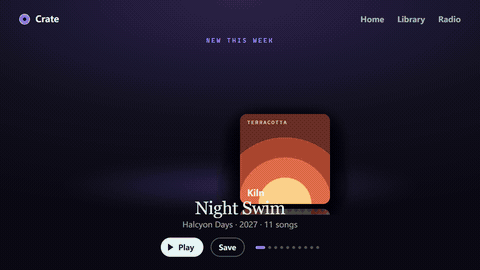

# Orbit Gallery · `<ane-orbit-gallery>`



**Real DOM cards on a tilted 3D ring.** Put any elements inside: images, cards, links. Drag or fling the ring and it **coasts** with friction, then **springs onto** the nearest card. Click a side card to **bring it round**. Use the **arrow keys**, or let it **autoplay**. Cards further round **shrink, dim and fade**. Tabbing into a card turns the ring to it, and the front card can **pop** forward over a soft **floor reflection**.

**[Open the playground →](https://anticipate218.github.io/ai-native-effects/effects/orbit-gallery.html)** · [中文文档](../zh-CN/effects/orbit-gallery.md)

## Install

```html
<!-- CDN, no build step -->
<script type="module" src="https://anticipate218.github.io/ai-native-effects/cdn/effects/orbit-gallery.js"></script>
```

```bash
npm install github:anticipate218/ai-native-effects
```

```ts
import 'ai-native-effects/orbit-gallery';
```

## Usage

```html
<ane-orbit-gallery card-width="180" tilt="10" reflect aria-label="New releases">
  <a href="/albums/night-swim"></a>
  <a href="/albums/static-bloom"></a>
  <!-- … any elements: images, cards, links -->
</ane-orbit-gallery>
```

```ts
const ring = document.querySelector('ane-orbit-gallery')!;
ring.addEventListener('ane-orbit-change', (e) => showDetails(e.detail.index));
ring.next(); // or ring.prev(), ring.goTo(3), ring.index = 3
```

Every direct child is a card. Cards share a width (`card-width`), and their height follows their content. Style them as you like: the gallery only sets their transform, opacity and visibility. Each card gets `data-current` when it is at the front, and `--ane-depth` (0 at the front, 1 at the back) for your own effects:

```css
ane-orbit-gallery > [data-current] { outline: 2px solid #8b7bff; }
```

## API

| Attribute | Values | Default | Description |
| --- | --- | --- | --- |
| `card-width` | px | `200` | Width of every card. |
| `radius` | px | auto | Ring radius; by default from the card count and width. |
| `tilt` | `-30`–`30` | `10` | Camera tilt in degrees: the back of the ring rises. The front card stays at the same height. |
| `facing` | `0`–`1` | `0.6` | How much cards turn with the ring: `0` = always face you, `1` = radial. |
| `pop`, `dim` | `0`–`0.5`, `0`–`1` | `0.12`, `0.6` | Extra scale of the front card; darkening towards the back. |
| `perspective` | px | `1400` | CSS perspective (lower = stronger depth). |
| `autoplay` | ms | `0` (off) | Advance one card every N ms; pauses on hover, focus and drag. |
| `wheel` | `horizontal` `on` `off` | `horizontal` | Sideways trackpad scrolling turns the ring; `on` = any wheel (it then captures vertical scrolling). |
| `reflect` | boolean | off | Soft floor reflection (`-webkit-box-reflect`: Chromium and Safari). |
| `accent` | colour | `#8b7bff` | Floor glow and focus ring. |
| `size`, `speed`, `motion` | | `420px`, `1`, `auto` | Height; autoplay time scale; reduced motion. |

| Member | Description |
| --- | --- |
| `ane-orbit-change` | The front card changed (`detail.index`). Fires while dragging too, so details can follow live. |
| `index`, `goTo(i)`, `next()`, `prev()` | The front card; turn the short way round to a card. |
| `position`, `moving` | Continuous ring position in cards; whether it is still moving. |
| `::part(ring)`, `::part(floor)`, `--ane-orbit-accent` | Styling hooks. |

## How it works

- **Ring.** Card *i* sits at angle `(i − position) × 360° / n` on a circle, translated in 3D and turned by `facing × angle`. The ring is tilted around its centre and lifted back, so the front card stays where you put it.
- **Depth.** Cards dim with `--ane-depth`, fade out past about 90° round, and fade when seen nearly edge-on. The back half is hidden and not clickable.
- **Physics.** Dragging follows the pointer one card per arc length. On release, the ring coasts with friction (velocity is capped), then a spring settles it on the card where the fling would have stopped. Programmatic turns use the same spring, always the short way round.
- **Clicks.** A press without a drag on a side card turns the ring and swallows that click, so the card's link only fires once the card is at the front. A drag never clicks.

## Accessibility and performance

- `role="region"` with `aria-roledescription="carousel"` (label it with `aria-label`). Cards get `aria-roledescription="slide"` and, if they have no label, "3 of 10".
- The host is focusable: ← → ↑ ↓, Home and End turn the ring. Tabbing into a card's link turns that card to the front. When the ring settles, the front card is announced ("4 of 10: Glasshouse").
- Reduced motion: turns jump instead of spinning, there is no coasting, and autoplay is off. Dragging still follows your finger.
- DOM and CSS 3D only: one transform and opacity per card per frame while moving, and nothing at rest. Touch: horizontal drags turn the ring, while vertical page scrolling still works (`touch-action: pan-y`).
