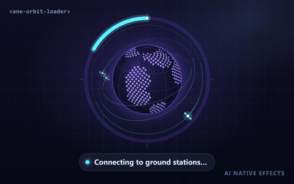

# Orbit Data Loader · `<ane-orbit-loader>`



A loader for the slow parts of AI and geo products. Satellites downlink data packets to a procedural planet while the ring fills, so a long download, index or sync looks like work in progress instead of a frozen spinner. It works with real progress (`progress="0.42"`) or without it (indeterminate), and has distinct **complete** and **failed** states.

**[Open the playground →](https://anticipate218.github.io/ai-native-effects/effects/orbit-loader.html)** · [中文文档](../zh-CN/effects/orbit-loader.md)

## When to use it

- Downloading or preprocessing satellite imagery, map tiles or other large datasets.
- Building a vector index, syncing a knowledge base, uploading files for retrieval.
- Any job that takes tens of seconds: the moving satellites signal "still working" even when progress stalls.
- Indeterminate phases (connecting, queueing) that later switch to real progress without swapping components.

## States

| State | How to get it | What it shows |
| --- | --- | --- |
| Indeterminate | no `progress` attribute (or `progress = null`) | A comet arc chases around the ring; downlinks keep flowing. |
| Determinate | `progress="0"`…`"1"` (or `"0%"`…`"100%"`) | The arc eases to the value with a bright head, so coarse updates still look smooth. |
| Complete | `progress="1"` | A shockwave leaves the planet, the continents flash in the accent color, the ring closes and glows; downlinks stop. Fires `ane-complete` once. |
| Failed | `error` attribute | Ring and satellites switch to `--ane-danger`; downlinks stop. |

Switching between indeterminate and determinate cross-fades the two ring styles, and the determinate arc always starts from empty.

## Install

```html
<!-- CDN, no build step -->
<script type="module" src="https://anticipate218.github.io/ai-native-effects/cdn/effects/orbit-loader.js"></script>
```

```bash
npm install github:anticipate218/ai-native-effects
```

```ts
import 'ai-native-effects/orbit-loader';
```

## Usage

```html
<ane-orbit-loader progress="0.42" show-value label="Downloading satellite tiles"></ane-orbit-loader>
```

Driving it from a download:

```ts
const loader = document.querySelector('ane-orbit-loader')!;
loader.addEventListener('ane-complete', () => showResults());

loader.progress = null; // indeterminate while connecting
try {
  for await (const chunk of download(url)) {
    loader.progress = chunk.loaded / chunk.total; // 0 … 1
  }
} catch {
  loader.error = true;
}
```

React and Vue need no wrapper; pass `progress` as a prop (leave it `undefined` for indeterminate):

```tsx
import 'ai-native-effects/orbit-loader';

export const Download = ({ progress }: { progress?: number }) => (
  <ane-orbit-loader show-value progress={progress} />
);
```

## API

### Attributes

| Attribute | Values | Default | Description |
| --- | --- | --- | --- |
| `progress` | `0`–`1` or `0%`–`100%` | none | Progress. Omit for indeterminate. Reaching `1` plays the completion pulse. |
| `satellites` | `1`–`6` | `3` | Number of orbiting satellites. |
| `error` | boolean | off | Failed state. |
| `show-value` | boolean | off | Shows the percentage over the planet. |
| `color` | any CSS color | `#7c5cff` | Planet color; ocean, land, graticule and ring track are derived from it. |
| `accent` | any CSS color | `#5ef2ff` | Satellites, downlinks and the progress arc. |
| `size` | CSS length | `240px` | Width and height. Plain CSS `width` works too. |
| `speed` | `0`–`5` | `1` | Animation time scale. `0` freezes the scene. |
| `motion` | `auto` `reduce` `full` | `auto` | `auto` follows `prefers-reduced-motion`. |
| `label` | string | `Loading data` | Accessible name of the progress bar. |
| `seed` | integer | `7` | Seed for the planet's continents and the orbits. |

### Properties and events

| Member | Description |
| --- | --- |
| `progress` | `number \| null`; `null` means indeterminate. Reflects to the attribute. |
| `error`, `satellites` | Reflect to their attributes. |
| `ane-complete` | Fired once each time progress reaches 100% (re-armed when progress drops below 1). `event.detail = { at }`; bubbles and crosses shadow roots. |

### CSS custom properties

| Property | Description |
| --- | --- |
| `--ane-size` | Width and height (default `240px`). |
| `--ane-orbit-color`, `--ane-orbit-accent` | Theme colors; the attributes take precedence. |
| `--ane-danger` | Failed-state color shared by all effects. |

## Accessibility

- The element exposes `role="progressbar"` with `aria-valuemin`, `aria-valuemax`, `aria-valuenow` (omitted while indeterminate) and an `aria-valuetext` of `Loading`, `42%`, `Complete` or `Failed`. Give it a specific `label` such as "Downloading satellite tiles".
- The canvas is decorative (`aria-hidden`); the optional percentage is mirrored in `aria-valuetext`.
- Reduced motion: the planet stops spinning, satellites hold their positions, downlinks, trails and the completion shockwave are off, and progress jumps instead of easing. The indeterminate ring becomes a fixed arc with a slow opacity pulse.
- States differ by more than color: arc length, the closed ring and the stopped downlinks.

## Performance

- One Canvas 2D layer, no dependencies, no images. The planet is generated once from the seed (spherical caps with wobbly coasts sampled on a 1,500-point Fibonacci sphere) and drawn as dots batched into four depth layers.
- Orbit paths and gradients are precomputed on resize; each frame transforms about 500 land points and draws a few dozen paths.
- The animation loop pauses while the element is off-screen, and the canvas resolution follows `devicePixelRatio` (capped at 2).
- No map data is used, so there is nothing to license.
