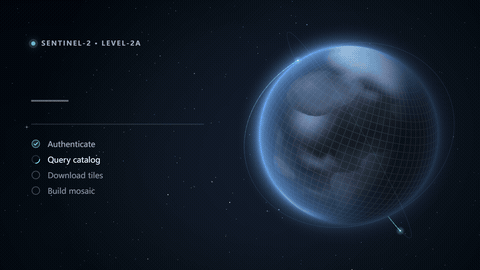

# Orbit Loading Screen · `<ane-orbit-loading-screen>`



A full loading screen for the long waits in AI and geo products: fetching satellite imagery, syncing a dataset, building an index, warming up a workspace. A WebGL planet is "downloaded" tile by tile. Regions that have not arrived yet show a blurred, desaturated preview; finished tiles snap into full detail with a glowing frontier while satellites sweep their swaths. Next to it, a typographic panel shows the percentage, the steps and live details.

**[Open the playground →](https://anticipate218.github.io/ai-native-effects/effects/orbit-loading-screen.html)** · [中文文档](../zh-CN/effects/orbit-loading-screen.md)

## When to use it

- First-run or workspace boot screens for data-heavy apps (GIS, remote sensing, analytics, ML notebooks).
- Long downloads and uploads where users need to see that work is really happening and what step it is on.
- Any wait of more than a few seconds: it starts indeterminate and switches to real progress without swapping components.

## States

| State | How | What it shows |
| --- | --- | --- |
| Indeterminate | no `progress` (or `progress = null`) | The whole planet is a blurred preview; a scan band sweeps the survey grid; the number shows a dash and the bar a moving sweep. |
| Downloading | `progress="0.42"` (or `"42%"`) | Tiles are acquired along diagonal ground-track swaths, south to north; fresh tiles glow; satellites cast sensor swaths. Coarse updates are eased. |
| Complete | `progress="1"` | The grid flashes once and fades, the atmosphere blooms, all steps turn done, the tone switches to `--ane-success`. Fires `ane-complete` once. |
| Failed | `error` | Danger tone, the active step shows a cross, swaths stop. |

## Install

```html
<!-- CDN, no build step -->
<script type="module" src="https://anticipate218.github.io/ai-native-effects/cdn/effects/orbit-loading-screen.js"></script>
```

```bash
npm install github:anticipate218/ai-native-effects
```

```ts
import 'ai-native-effects/orbit-loading-screen';
```

## Usage

Inline in a layout (the width follows the container; `size` sets the height):

```html
<ane-orbit-loading-screen
  size="520px"
  eyebrow="Sentinel-2 · Level-2A"
  heading="Downloading imagery"
  steps="Authenticate|Query catalog|Download tiles|Build mosaic"
  step="2"
  progress="0.42"
  detail="0.82 GB of 1.94 GB · 41 MB/s · 0:24 left"
>
  <button slot="actions">Run in background</button>
</ane-orbit-loading-screen>
```

As a full-page boot screen:

```html
<ane-orbit-loading-screen fullscreen heading="Preparing your workspace"></ane-orbit-loading-screen>
```

Driving it from a download:

```ts
const screen = document.querySelector('ane-orbit-loading-screen')!;
screen.steps = ['Authenticate', 'Query catalog', 'Download tiles', 'Build mosaic'];
screen.addEventListener('ane-complete', () => screen.remove());

screen.step = 2;
screen.progress = null; // indeterminate until the size is known
try {
  for await (const chunk of download(url)) {
    screen.progress = chunk.loaded / chunk.total;
    screen.setAttribute('detail', `${gb(chunk.loaded)} of ${gb(chunk.total)}`);
    screen.setAttribute('status', `tile ${chunk.tileId} · ok`);
  }
} catch {
  screen.error = true;
  screen.setAttribute('heading', 'Download interrupted');
}
```

React and Vue need no wrapper: pass attributes as props (`progress={undefined}` for indeterminate).

## API

### Attributes

| Attribute | Values | Default | Description |
| --- | --- | --- | --- |
| `progress` | `0`–`1` or `0%`–`100%` | none | Progress; omit while the total is unknown. |
| `heading` | string | `Preparing your workspace` | Main line. Changes fade in. |
| `eyebrow` | string | `Loading` | Small caps line with a status beacon. |
| `steps` | `A\|B\|C` | none | Pipe-separated step labels. |
| `step` | integer | `0` | Active step (0-based); earlier steps show as done. |
| `detail` | string | none | Secondary line: sizes, speed, time left. |
| `status` | string | none | Monospace log line (hidden on short screens). |
| `error` | boolean | off | Failed state. |
| `satellites` | `0`–`4` | `2` | Satellites sweeping the planet. |
| `accent` | any CSS color | `#5ef2ff` | Fresh tiles, swaths, bar and step marks. |
| `color` | any CSS color | `#6aa6ff` | Atmosphere and preview tint. |
| `fullscreen` | boolean | off | Covers the viewport (`position: fixed`). |
| `size` | CSS length | `480px` | Height. Width follows the container; below 640px the layout stacks. |
| `quality` | `auto` `high` `low` | `auto` | WebGL resolution; `auto` lowers it when frames run long. |
| `speed` | `0`–`5` | `1` | Animation time scale. |
| `motion` | `auto` `reduce` `full` | `auto` | `auto` follows `prefers-reduced-motion`. |
| `label` | string | the heading | Accessible name of the progress bar. |
| `seed` | integer | `7` | Seed for the planet, orbits and stars. |

### Properties, slots, parts and events

| Member | Description |
| --- | --- |
| `progress` | `number \| null`; `null` = indeterminate. Reflects to the attribute. |
| `steps` | `string[]`, reflects to `steps`. |
| `step`, `error`, `satellites` | Reflect to their attributes. |
| `webgl` | Read-only; `false` when the 2D fallback is in use. |
| `slot="actions"` | Buttons under the panel (Cancel, Run in background…). |
| `::part(screen)`, `::part(panel)` | Styling hooks. |
| `ane-complete` | Fired once each time progress reaches 100% (re-armed when it drops). `event.detail = { at }`. |

### CSS custom properties

| Property | Description |
| --- | --- |
| `--ane-size` | Height (default `480px`). |
| `--ane-screen-bg`, `--ane-screen-text` | Background and text colors. |
| `--ane-screen-z` | z-index in full-screen mode. |
| `--ane-success`, `--ane-danger` | Complete and failed tones shared by all effects. |

## Accessibility

- The panel is real text in the DOM. The meter is a `role="progressbar"` named by the heading (or `label`), with `aria-valuenow` (omitted while indeterminate) and `aria-valuetext` (`Loading`, `42%`, `Complete`, `Failed`).
- Steps are an ordered list; the active step has `aria-current="step"` and every step carries hidden status text ("done", "in progress", "pending", "failed").
- The canvases are decorative (`aria-hidden`). Text colors meet WCAG AA on the default background.
- Reduced motion: the planet, clouds and satellites hold still, swaths, twinkles and the completion flash are off, the step spinner stops and progress jumps instead of easing. Tiles still fill in, so progress stays visible.
- In full-screen mode, put a focusable control in the `actions` slot (the playground uses "Exit full screen" and Esc).

## Performance

- Three layers: a WebGL2 canvas sized to the planet and its halo only, a 2D overlay for orbits and satellites, and DOM text. The starfield is painted once per resize.
- Planet textures (elevation, clouds, settlements, ice) are baked once per seed into a 1024×512 texture with a single draw call. Each frame is one full-canvas triangle plus a few dozen 2D strokes; JS work per frame stays well under 1 ms.
- `quality="auto"` lowers the WebGL resolution when the average frame takes longer than about 26 ms. The canvas resolution follows `devicePixelRatio` (capped at 2).
- The animation loop pauses off-screen, and the WebGL context is released when the element is removed (browsers cap live contexts).
- Without WebGL2 the planet falls back to a painted 2D sphere; everything else works the same.
