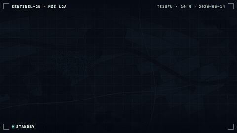

# Satellite Scan Reveal · `<ane-scan-reveal>`



Every remote-sensing product has two waits: the imagery arriving, and the model working on it. `<ane-scan-reveal>` turns both into satellite sweeps. A push-broom sensor line reveals the scene; band misregistration fringes and detector striping calibrate away just behind it. Then a dashed inference line lays the model's land-cover mask over the image, with crisp class outlines and fresh detections glowing as they appear. A HUD frames it all with sensor labels, live status and a legend.

Bring your own image and mask, or leave `src` out and it generates a seeded farmland scene (parcels, hedgerows, a river, forest and a town) together with its class mask.

**[Open the playground →](https://anticipate218.github.io/ai-native-effects/effects/scan-reveal.html)** · [中文文档](../zh-CN/effects/scan-reveal.md)

## When to use it

- Opening a scene in a GIS or Earth-observation viewer while tiles download.
- Showing segmentation, change detection or classification results arriving from a model.
- Landing pages and demos for remote-sensing AI, with no imagery licensing (procedural scene).

## Modes

| Mode | How | Behaviour |
| --- | --- | --- |
| Autoplay | no `progress` attribute | Acquisition over `duration` ms, then inference (85% of it). `loop` repeats; `replay()` restarts. |
| Driven | `progress` (and `analysis`) | Your app reports real progress, e.g. tiles loaded and inference steps. Values are eased between updates. |

The phase (`standby → acquiring → analyzing → complete`) is exposed as `phase`, in the HUD and in the progressbar's `aria-valuetext`.

## Install

```html
<!-- CDN, no build step -->
<script type="module" src="https://anticipate218.github.io/ai-native-effects/cdn/effects/scan-reveal.js"></script>
```

```bash
npm install github:anticipate218/ai-native-effects
```

```ts
import 'ai-native-effects/scan-reveal';
```

## Usage

Procedural scene, autoplaying with a HUD:

```html
<ane-scan-reveal hud loop caption="Sentinel-2B · MSI L2A" detail="T31UFU · 10 m"></ane-scan-reveal>
```

Your imagery and model output, driven by real progress:

```html
<ane-scan-reveal
  hud
  src="https://example.com/scene.jpg"
  mask="https://example.com/landcover.png"
  classes="Water:#4cc9f0|Built-up:#ffb547|Trees:#3ddc97"
  alt="Sentinel-2 true colour over the Rhine delta, with a land-cover mask"
></ane-scan-reveal>
```

```ts
const scan = document.querySelector('ane-scan-reveal')!;
scan.addEventListener('ane-scan-complete', (event) => console.log(event.detail.pass));

scan.progress = tilesLoaded / tilesTotal;     // acquisition sweep
scan.analysis = stepsDone / stepsTotal;       // inference sweep
scan.progress = null;                         // back to autoplay
```

**Masks** are images the size (or ratio) of the scene: each class in its own colour, everything else transparent. The colours are drawn as-is; `classes` only sets the legend (and the colours of the procedural mask). **Cross-origin images** must be served with CORS headers for WebGL; otherwise the component falls back to a plain 2D wipe without the effects.

## API

### Attributes

| Attribute | Values | Default | Description |
| --- | --- | --- | --- |
| `src` | image URL | procedural scene | Imagery to reveal. |
| `mask` | image URL | procedural mask | Class mask for the inference sweep. |
| `alt` | string | `Satellite image` | Description of the image. |
| `progress` | `0`–`1` | none | Acquisition progress; present = driven mode. |
| `analysis` | `0`–`1` | `0` | Inference progress in driven mode. |
| `duration` | ms | `3600` | Autoplay acquisition length. |
| `loop` | boolean | off | Repeat autoplay. |
| `hud` | boolean | off | Brackets, labels, status and legend. |
| `caption`, `detail` | string | none | HUD labels (top left / top right). |
| `classes` | `Name:#hex\|…` | Water, Urban, Forest | Legend and procedural mask colours. |
| `accent` | any CSS color | `#5ef2ff` | Sensor line colour. |
| `angle` | degrees | `-9` | Ground-track tilt of the sweeps. |
| `ghost` | `0`–`1` | `0.18` | Visibility of the not-yet-acquired preview. |
| `ratio` | e.g. `16/9` | image ratio | Aspect ratio. |
| `seed` | integer | `7` | Procedural scene seed. |
| `size` | CSS length | `100%` | Width; height follows the ratio. |
| `speed`, `motion` | | `1`, `auto` | Time scale and reduced motion. |

### Properties, methods and events

| Member | Description |
| --- | --- |
| `progress`, `analysis` | Reflect to the attributes; `progress = null` returns to autoplay. |
| `phase` | `standby`, `acquiring`, `analyzing` or `complete`. |
| `replay()` | Restarts autoplay. |
| `webgl` | `false` when the 2D fallback is in use. |
| `ane-scan-complete` | Fired when a pass finishes; `event.detail.pass` is `acquisition` or `analysis`. |

CSS: `--ane-size` (width), `--ane-scan-radius` (corner radius, default `14px`).

## Accessibility

- The canvas is an image (`role="img"`) labelled by `alt`. A visually hidden progressbar reports overall progress with `aria-valuetext` such as "Analyzing 40%" or "Complete". The HUD is decorative.
- Reduced motion: autoplay shows the finished result at once; in driven mode the sweeps still follow progress, with hard edges and no fringes, striping, glow or moving dashes.

## Performance

- One WebGL2 draw per frame, and only while something changes: when the sweeps are idle, nothing is redrawn. Effects are plain texture taps; the procedural scene is baked once per seed (two 1600 px textures).
- Images larger than the GPU texture limit are downscaled once on load; mipmaps keep large images crisp when shown small.
- The loop pauses off-screen, and the WebGL context is released when the element is removed.
