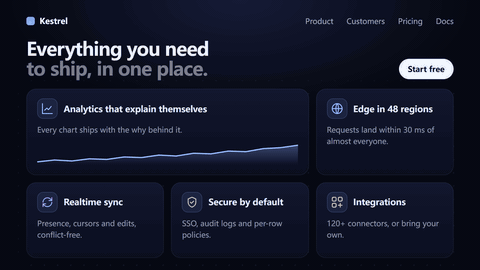

# Spotlight Grid · `<ane-spotlight-grid>`



**One shared light for a whole wall of cards.** The light follows the pointer with a little inertia and lights card borders by distance, so neighbours glow too, right across the gaps. A **dot grid** appears behind the cards only where the light reaches, the card surfaces catch a soft **sheen**, and a click sends a **light wave** through the wall that lights each border as it passes. When nobody is pointing, the light **drifts** slowly. Your cards stay your own markup; style the element as your grid.

**[Open the playground →](https://anticipate218.github.io/ai-native-effects/effects/spotlight-grid.html)** · [中文文档](../zh-CN/effects/spotlight-grid.md)

## Install

```html
<!-- CDN, no build step -->
<script type="module" src="https://anticipate218.github.io/ai-native-effects/cdn/effects/spotlight-grid.js"></script>
```

```bash
npm install github:anticipate218/ai-native-effects
```

```ts
import 'ai-native-effects/spotlight-grid';
```

## Usage

The element is the grid container; its children are the cards.

```html
<ane-spotlight-grid style="display:grid;grid-template-columns:repeat(3,1fr);gap:12px;padding:14px">
  <article class="card" style="grid-column:span 2">…</article>
  <article class="card">…</article>
  <article class="card">…</article>
  <article class="card">…</article>
  <article class="card">…</article>
</ane-spotlight-grid>
```

```ts
const wall = document.querySelector('ane-spotlight-grid')!;
wall.pulse();          // light wave from the centre
wall.pulse(120, 80);   // …or from a point (element coordinates)
```

Tips: give the cards an **opaque** background so the dot grid shows in the gaps only, and leave a little `padding` on the element so the light has room around the wall. The lit border follows each card's own `border-radius`.

## API

| Attribute | Values | Default | Description |
| --- | --- | --- | --- |
| `color` | CSS colour | `#8ab4ff` | Light colour. |
| `accent` | CSS colour | `#c58bff` | Dots, wave and the light's outer tint. |
| `radius` | CSS length | `340px` | Reach of the light. |
| `intensity` | `0`–`1` | `1` | Brightness. |
| `border` | CSS length | `1.5px` | Width of the lit border. |
| `sheen` | `0`–`1` | `0.75` | Light on the card surfaces. |
| `dots` | `on` `off` | `on` | Dot grid revealed by the light. |
| `dot-gap` | CSS length | `22px` | Dot spacing. |
| `idle` | `on` `off` | `on` | Slow drift while nobody points. |
| `speed`, `motion` | | `1`, `auto` | Time scale, reduced motion. |

| Member | Description |
| --- | --- |
| `pulse(x?, y?)` | Sends a light wave from a point (default: centre). Clicking does this too. |
| `cards` | The slotted cards. |
| `::part(background)`, `--ane-spot-color`, `--ane-spot-accent`, `--ane-spot-radius`, `--ane-spot-border`, `--ane-spot-sheen`, `--ane-spot-dot-gap` | Styling hooks. |

## How it works

- **One light, many rings.** For every card, the shadow root holds a border ring (a box masked down to its border) and a sheen layer, positioned over the card. Each frame writes only three custom properties on the host (`--x`, `--y`, `--i`); every ring computes its radial gradient from its own offset, so one light spans the whole wall.
- **Inertia.** The light runs on a spring towards the pointer, the focused card or the idle drift path, and stops writing once it has settled.
- **Waves.** A wave's front moves at 1100 px/s; each card brightens by a soft band around the front, based on the distance from the click to the nearest point of the card.
- **Layout.** Card rectangles are measured only when something resizes (ResizeObserver), never per frame.

## Accessibility and performance

- The light is decorative (`aria-hidden` layers); your cards keep their semantics. Focusing a card (or something inside it) moves the light to it.
- Touch: drag to move the light; tap sends a wave.
- Reduced motion: the light moves without inertia, does not drift and sends no waves.
- DOM and CSS only; a handful of custom-property writes per frame. The loop pauses off-screen.
