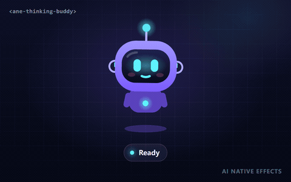

# AI Thinking Buddy · `<ane-thinking-buddy>`



A tiny robot that makes agent status readable at a glance. Each state has its own body language **and** a badge, so users can tell *thinking* from *waiting on a tool* from *done* without reading a word.

**[Open the playground →](https://anticipate218.github.io/ai-native-effects/effects/thinking-buddy.html)** · [中文文档](../zh-CN/effects/thinking-buddy.md)

## When to use it

- Chat assistants and copilots: next to the composer or the latest message.
- Agent dashboards: one buddy per run or per worker.
- Long-running jobs (code generation, data pipelines, deployments) where a progress bar would lie.
- Empty states and onboarding, where a friendly character sets the tone.

## States

| State | Body language | Badge | Map it to |
| --- | --- | --- | --- |
| `idle` | Gentle hover, random glances and blinks | none | Ready; nothing running |
| `thinking` | Looks up, head tilts, ear dials spin, antenna pulses | Thought cloud with bouncing dots | Model is generating or planning |
| `waiting` | Glances at the hourglass, taps an arm impatiently | Flipping hourglass | Tool call in flight, rate limit, waiting for approval or user input |
| `success` | Jumps with squash and stretch, happy eyes, confetti | Check mark that draws itself | Final answer delivered, task completed |
| `error` | Head shake, `> <` eyes, drooping antenna with sparks, sweat drop | Wiggling `!` | Exception, failed tool call, refused request |

Every change of `state` plays a short one-time entry reaction (the jump, the shake), then settles into a loop. Call `replay()` to play the entry again, e.g. when a second task succeeds.

## Install

```html
<!-- CDN, no build step -->
<script type="module" src="https://anticipate218.github.io/ai-native-effects/cdn/effects/thinking-buddy.js"></script>
```

```bash
npm install github:anticipate218/ai-native-effects
```

```ts
import 'ai-native-effects/thinking-buddy';
```

## Usage

```html
<ane-thinking-buddy state="thinking" size="120px"></ane-thinking-buddy>
```

Driving it from an agent loop:

```ts
const buddy = document.querySelector('ane-thinking-buddy')!;

agent.on('start', () => (buddy.state = 'thinking'));
agent.on('tool_call', () => (buddy.state = 'waiting'));
agent.on('tool_result', () => (buddy.state = 'thinking'));
agent.on('done', () => (buddy.state = 'success'));
agent.on('error', () => (buddy.state = 'error'));

buddy.addEventListener('ane-statechange', (event) => {
  console.log(`${event.detail.previous} → ${event.detail.state}`);
});
```

Theming:

```html
<ane-thinking-buddy color="#ff7a59" accent="#fff3b0"></ane-thinking-buddy>

<style>
  /* or with CSS custom properties, e.g. per theme */
  .dark ane-thinking-buddy { --ane-buddy-color: #4f46e5; --ane-buddy-accent: #67e8f9; }
  ane-thinking-buddy.compact { --ane-size: 48px; }
</style>
```

## API

### Attributes

| Attribute | Values | Default | Description |
| --- | --- | --- | --- |
| `state` | `idle` `thinking` `waiting` `success` `error` | `idle` | What the agent is doing. Unknown values fall back to `idle`. |
| `color` | any CSS color | `#7c5cff` | Body color; highlights and shading are derived from it. |
| `accent` | any CSS color | `#5ef2ff` | Eyes, mouth and the idle/thinking glow. |
| `size` | CSS length | `160px` | Width and height. Plain CSS `width` works as well. |
| `speed` | `0`–`5` | `1` | Animation time scale. `0` freezes the buddy. |
| `motion` | `auto` `reduce` `full` | `auto` | `auto` follows `prefers-reduced-motion`. |
| `interactive` | boolean | off | Eyes follow the pointer; a tap or click plays a happy bounce. |
| `announce` | boolean | off | Announces state changes through a polite live region. |
| `label` | string | per state | Overrides the accessible label for every state. |
| `seed` | integer | `7` | Seed for blinks, glances and confetti. |

### Properties and methods

| Member | Description |
| --- | --- |
| `state` | Get or set the state; reflects to the attribute. |
| `labels` | Per-state accessible labels, e.g. `{ thinking: '正在思考' }`. Merged over the English defaults. |
| `speed` | Current time scale (number). |
| `reducedMotion` | `true` while the calm variant is active (read-only). |
| `replay()` | Replays the entry animation of the current state. |
| `boop()` | Plays the happy bounce. |

### Events

| Event | Detail | Notes |
| --- | --- | --- |
| `ane-statechange` | `{ state, previous }` | Fired on every state change; bubbles and is `composed`. Not fired for the initial state. |

### CSS custom properties

| Property | Default | Description |
| --- | --- | --- |
| `--ane-size` | `160px` | Width and height. |
| `--ane-buddy-color` | `#7c5cff` | Body color (the `color` attribute wins). |
| `--ane-buddy-accent` | `#5ef2ff` | Accent color (the `accent` attribute wins). |
| `--ane-success` / `--ane-warning` / `--ane-danger` | `#3ddc97` / `#ffb547` / `#ff5d6c` | Status colors shared by all effects. |

## Accessibility

- The robot is an SVG with `role="img"` and a state-specific `aria-label` ("AI assistant is thinking"…). Localise it with the `labels` property or override it with `label`.
- Add `announce` to have screen readers announce state changes politely. Leave it off if your app already announces status text, to avoid double announcements.
- With `prefers-reduced-motion: reduce` (or `motion="reduce"`) the buddy stops hovering, jumping, shaking and throwing confetti. Expressions, badges and colors still change, so the state stays readable.
- The badge never relies on color alone: each state has a distinct shape (cloud, hourglass, check, exclamation mark).
- Pair the buddy with a text status ("Waiting for tool result…") for the clearest experience, as in the playground.

## Performance

- Pure SVG with a fixed number of nodes; each frame only updates transforms and opacities.
- All effects share a single `requestAnimationFrame` loop that stops when no effect is visible. Each buddy unsubscribes while off-screen (IntersectionObserver) or detached.
- The e2e suite enforces a mean JS cost below 2 ms per frame; a buddy typically uses well under 0.2 ms.

## TypeScript and React

The package ships declarations for the element class and for `document.createElement('ane-thinking-buddy')`. To type the JSX tag in React 19, declare it once:

```ts
// custom-elements.d.ts
import type { ThinkingBuddyElement } from 'ai-native-effects/thinking-buddy';
import type { DetailedHTMLProps, HTMLAttributes } from 'react';

declare module 'react' {
  namespace JSX {
    interface IntrinsicElements {
      'ane-thinking-buddy': DetailedHTMLProps<HTMLAttributes<ThinkingBuddyElement>, ThinkingBuddyElement> & {
        state?: 'idle' | 'thinking' | 'waiting' | 'success' | 'error';
        color?: string;
        accent?: string;
        size?: string;
        speed?: number | string;
        motion?: 'auto' | 'reduce' | 'full';
        interactive?: boolean;
        announce?: boolean;
      };
    }
  }
}
```

## Custom tag name

```ts
import { defineThinkingBuddy } from 'ai-native-effects/thinking-buddy';
defineThinkingBuddy('my-status-bot'); // registers under a second name too
```

The class is exported as `ThinkingBuddyElement` if you prefer `customElements.define` yourself.
