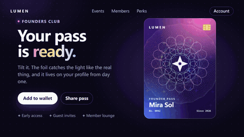

# Holographic Tilt Card · `<ane-tilt-holo-card>`



A card that **tilts towards the pointer on springs** and catches the light like a real holographic print. A procedural **foil** (glitter, grooves or scales) shows a rainbow only where the light hits, a broad **iridescent band** and a **glare** follow the pointer, the **rim** shimmers and the shadow moves the other way. Your own HTML goes inside. When nobody touches it, the card **sways gently**; on phones it can follow the **gyroscope**.

**[Open the playground →](https://anticipate218.github.io/ai-native-effects/effects/tilt-holo-card.html)** · [中文文档](../zh-CN/effects/tilt-holo-card.md)

## Install

```html
<!-- CDN, no build step -->
<script type="module" src="https://anticipate218.github.io/ai-native-effects/cdn/effects/tilt-holo-card.js"></script>
```

```bash
npm install github:anticipate218/ai-native-effects
```

```ts
import 'ai-native-effects/tilt-holo-card';
```

## Usage

```html
<!-- An image… -->
<ane-tilt-holo-card ratio="5/7">
  
</ane-tilt-holo-card>

<!-- …or any markup, e.g. a link so keyboard users can reach it -->
<ane-tilt-holo-card foil="scales" size="280px" gyro>
  <a href="/pass" class="pass-face">
    <span>Founder pass</span>
    <strong>Mira Sol</strong>
  </a>
</ane-tilt-holo-card>
```

The card clips your content to its rounded corners. Without `ratio`, its height comes from the content. On dark artwork the default `color-dodge` foil glows; on light cards try `blend="screen"` or `blend="soft-light"`.

## API

| Attribute | Values | Default | Description |
| --- | --- | --- | --- |
| `size` | CSS length | `300px` | Card width (never wider than its container). |
| `tilt` | `0`–`35` | `16` | Maximum tilt in degrees. |
| `foil` | `sparkle` `lines` `scales` `none` | `sparkle` | Procedural foil pattern. `none` lets the rainbow cover the whole card. |
| `foil-strength` | `0`–`1` | `0.85` | Strength of the foil rainbow. |
| `sheen` | `0`–`1` | `0.55` | Broad iridescent band under the light. |
| `glare` | `0`–`1` | `0.8` | White highlight that follows the pointer. |
| `blend` | `color-dodge` `screen` `overlay` `soft-light` `hard-light` `plus-lighter` | `color-dodge` | How the foil mixes with your content. |
| `hue` | degrees | `0` | Shifts the rainbow. |
| `radius` | CSS length | `18px` | Corner radius. |
| `ratio` | e.g. `5/7` | from content | Aspect ratio of the card. |
| `perspective` | CSS length | `800px` | 3D depth; smaller is more dramatic. |
| `idle` | `on` `off` | `on` | Slow sway while nobody is touching the card. |
| `gyro` | boolean | off | Follow device orientation on phones. iOS asks for permission at the first tap on the card. |
| `seed` | integer | `7` | Foil pattern seed. |
| `speed`, `motion` | | `1`, `auto` | Time scale, reduced motion. |

| Member | Description |
| --- | --- |
| `tiltAngles` | Current `[rotateX, rotateY]` in degrees (read-only). |
| `::part(card)`, `::part(foil)`, `::part(sheen)`, `::part(glare)`, `::part(shadow)`, `::part(stage)` | The layers. |
| `--ane-holo-bg`, `--ane-holo-radius` | Background behind your content; corner radius. |

## How it works

- **One set of variables.** Each frame writes six custom properties on the host (`--rx`, `--ry`, `--px`, `--py`, `--hue`, `--lit`). CSS does the rest: the 3D transform, gradient positions and mask positions. Nothing is written once the springs settle (unless the idle sway is on).
- **Foil.** A 160 px tile of glitter, grooves or scales is drawn once on a canvas (seeded, cached) and used as a mask. It is intersected with a radial spotlight at the pointer, so the rainbow only appears where the pattern is *and* the light falls. The rainbow's hue rolls with the tilt.
- **Springs.** Tilt and light position run on semi-implicit springs; hovering lifts the card slightly and brightens every layer.
- **Hit area.** Pointer events are read on the untransformed host, so a tilted corner never "escapes" the cursor and makes the card flicker.

## Accessibility and performance

- The card is presentational. Your content keeps its semantics; a focused link or button inside tilts the card towards the light like a hover.
- Touch: drag across the card to tilt it; vertical scrolling still works (`touch-action: pan-y`).
- Reduced motion: no tilt, no sway, no lift. The foil sits at a fixed angle and only brightens on hover or focus.
- DOM and CSS only (the canvas is used once to draw the foil tile). The loop pauses off-screen.
