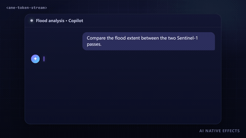

# Token Stream Text · `<ane-token-stream>`



Streamed LLM answers arrive in uneven bursts: a few tokens, a pause, then a paragraph at once. Appending them raw makes the text stutter and jump. `<ane-token-stream>` buffers the chunks, releases words at an adaptive pace and lets each one rise out of a blur and "dry" from the accent color behind a glowing caret. The output is real, selectable text, in English, Chinese, Japanese or any other script.

**[Open the playground →](https://anticipate218.github.io/ai-native-effects/effects/token-stream.html)** · [中文文档](../zh-CN/effects/token-stream.md)

## When to use it

- Chat assistants, copilots and agent consoles that stream model output.
- Summaries, explanations and reports generated on the fly.
- Anywhere a response should feel written rather than dumped.

## How it works

1. **Safe tokenizing.** `write(chunk)` adds text to a buffer. Only units that cannot change are emitted: a half-arrived word, an unclosed `` `code` `` span, a lone `*` or a trailing newline (which might become a paragraph) wait for the next chunk.
2. **Segmentation.** Words come from `Intl.Segmenter`, so CJK text without spaces is split into words too. Punctuation stays attached to its word, so a comma never starts a line. In `char` mode each word is laid out first and its graphemes are revealed one by one, so lines never reflow and words never break.
3. **Adaptive pacing.** Units are released from a character budget at `rate` characters per second. When chunks pile up, the rate rises to drain the backlog with a time constant of about 0.8 s, so a 2,000-character burst never leaves the reader far behind.
4. **Ink.** Each new unit fades in over about 460 ms: blur → sharp, slightly lowered → in place, accent color → text color. Only units that are still animating are touched each frame; settled text carries no inline styles.
5. **Caret.** A slim glowing caret breathes while waiting, stays solid while writing and fades out after `done()`. A soft glow follows the writing position.

## Install

```html
<!-- CDN, no build step -->
<script type="module" src="https://anticipate218.github.io/ai-native-effects/cdn/effects/token-stream.js"></script>
```

```bash
npm install github:anticipate218/ai-native-effects
```

```ts
import 'ai-native-effects/token-stream';
```

## Usage

```html
<ane-token-stream rate="60"></ane-token-stream>
```

From a `fetch` response (bytes or text):

```ts
const answer = document.querySelector('ane-token-stream')!;
const response = await fetch('/api/chat', { method: 'POST', body: JSON.stringify({ prompt }) });
await answer.stream(response.body!); // resolves once everything is revealed
```

From an SDK that yields text deltas:

```ts
answer.reset();
for await (const delta of client.stream(prompt)) answer.write(delta);
answer.done();
answer.addEventListener('ane-stream-end', (event) => save(event.detail.text));
```

Text written inside the tag streams in when the component upgrades (and is readable before JavaScript loads):

```html
<ane-token-stream>Your report is **ready**.</ane-token-stream>
```

React and Vue need no wrapper; call `stream()` from an effect with a ref (see the playground's code tabs).

## API

### Attributes

| Attribute | Values | Default | Description |
| --- | --- | --- | --- |
| `rate` | characters / second | `60` | Base pace; rises automatically with the backlog. |
| `granularity` | `word` `char` | `word` | Reveal unit. |
| `caret` | `auto` `persist` `none` | `auto` | `auto` fades the caret out when done; `persist` keeps it breathing. |
| `color` | any CSS color | `currentColor` | Text color. |
| `accent` | any CSS color | `#7c5cff` | Ink, caret, glow and code tint. |
| `size` | CSS length | inherited | Font size. |
| `speed` | `0`–`5` | `1` | Time scale for pacing and ink. |
| `motion` | `auto` `reduce` `full` | `auto` | `auto` follows `prefers-reduced-motion`. |
| `announce` | boolean | off | Announces "Response complete" in a polite live region. |
| `label` | string | `Assistant response` | Accessible name of the text region. |

### Methods, properties and events

| Member | Description |
| --- | --- |
| `write(text)` | Adds a chunk. |
| `done()` | Ends the stream; the rest is revealed, then `ane-stream-end` fires. |
| `stream(source)` | Consumes an `AsyncIterable` or `ReadableStream` of strings or bytes (UTF-8), then calls `done()`. Returns a promise that resolves when fully revealed. |
| `skip()` | Reveals everything received so far without animation. |
| `reset()` | Clears the text for a new answer. |
| `text` | Everything received so far (including formatting markers). |
| `streaming` | `true` until the stream has ended and been fully revealed. |
| `finished` | Promise for the end of the current stream. |
| `ane-stream-end` | Fired once per stream. `event.detail = { text }`; bubbles and crosses shadow roots. |

Formatting: line breaks, blank-line paragraphs, `` `inline code` `` and `**bold**`. Render richer Markdown (tables, lists, code blocks) with your own renderer once the stream has ended.

### CSS

| Property / part | Description |
| --- | --- |
| `--ane-size` | Font size. |
| `--ane-stream-color`, `--ane-stream-accent` | Text and accent colors (attributes take precedence). |
| `::part(body)` | The text container. |

The component inherits `font-family` and `line-height` from the page, so it matches your typography.

## Accessibility

- The text is real DOM text in a labelled region with `aria-busy="true"` while streaming, so screen readers do not read half-written sentences; it switches to `false` at the end. Add `announce` to hear "Response complete".
- The caret and glow are decorative (`aria-hidden`).
- Reduced motion: pacing stays (it is the content arriving), but there is no blur, rise, color change, glow or blinking; new words only fade in briefly.
- Provide a way to skip the animation in long answers (`skip()`); the playground has a Skip button.

## Performance

- No canvas and no dependencies. Each frame writes styles only to the units still animating (typically a handful) and reads the caret position once per released unit.
- The animation loop pauses off-screen; settled units carry no inline styles, so long answers stay cheap.
