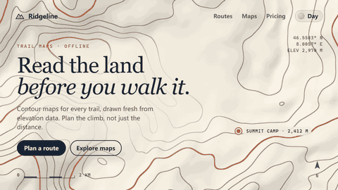

# Topography Lines · `<ane-topography>`



**A living contour map as a background.** Crisp contour lines with heavier **index contours**, stepped **elevation tints** and a soft **hillshade**, drawn in real time from a slowly drifting height field. Move the pointer and a **hill rises** under it, with its contours closing into rings; click or tap to send a **ripple** through the terrain. Light **paper** or dark themes, which **cross-fade** when you switch. Put your own content inside.

**[Open the playground →](https://anticipate218.github.io/ai-native-effects/effects/topography.html)** · [中文文档](../zh-CN/effects/topography.md)

## Install

```html
<!-- CDN, no build step -->
<script type="module" src="https://anticipate218.github.io/ai-native-effects/cdn/effects/topography.js"></script>
```

```bash
npm install github:anticipate218/ai-native-effects
```

```ts
import 'ai-native-effects/topography';
```

## Usage

```html
<ane-topography style="min-height: 520px">
  <h1>Read the land before you walk it.</h1>
</ane-topography>

<ane-topography theme="night" levels="20" fill="0.3"></ane-topography>
<ane-topography theme="paper" color="#33506b" accent="#d0572b" speed="0"></ane-topography>
```

```ts
const map = document.querySelector('ane-topography')!;
map.setAttribute('theme', 'night'); // cross-fades to the dark preset
map.ripple(320, 180, 1.5);          // a ripple from a point, in the element's CSS pixels
```

The element is a block that fills its width; give it a height (`min-height`, `size` or your layout). Content you put inside sits on top of the map.

## API

| Attribute | Values | Default | Description |
| --- | --- | --- | --- |
| `theme` | `paper` `night` `blueprint` `moss` | `paper` | Colour preset. Switching themes cross-fades. |
| `background`, `color`, `accent` | hex colours | from the theme | Paper, contour lines, index contours (and the top of the tint). |
| `levels` | `4`–`40` | `14` | Contour density. |
| `line-width` | `0.5`–`4` (CSS px) | `1.2` | Contour width (index contours are about 1.9× wider). |
| `index` | `0`–`10` | `5` | Every Nth contour is an index contour; `0` = none. |
| `scale` | `0.3`–`4` | `1` | Terrain feature size (higher = smaller features). |
| `relief` | `0`–`2` | `1` | Height of the pointer hill; `0` turns it off. |
| `ripples` | `on` `off` | `on` | Clicks and taps send ripples. |
| `fill`, `shade`, `grain` | `0`–`1` | `0.5`, `0.4`, `0.35` | Elevation tint, hillshade, paper grain. |
| `quality` | `0.4`–`1` | `1` | Render scale (also lowered automatically on slow devices). |
| `speed` | `0`–`5` | `1` | Drift speed of the terrain only. `0` = a still map; the hill and ripples still respond. |
| `seed`, `motion`, `size` | | `11`, `auto`, `260px` | Terrain seed, reduced motion, minimum height. |

| Member | Description |
| --- | --- |
| `ripple(x, y, strength = 1)` | Send a ripple from a point in the element's CSS pixels (e.g. when a form is sent). |
| `webgl` | Whether WebGL2 is running (otherwise a CSS fallback with faint rings shows). |
| `colors` | The resolved colours, `{ background, color, accent }` as 0–1 RGB. |
| `::part(content)` | The layer that holds your content. |

## How it works

- **Terrain.** A domain-warped fractal noise field (4 octaves) drifts slowly. It is stretched linearly rather than clamped: a clamped plateau would sit exactly on a contour and fill with ink.
- **Contours.** For each pixel, `height × levels` is compared to the nearest whole number and divided by its screen-space derivative (`fwidth`). This gives lines of constant pixel width at any slope, anti-aliased, without extracting geometry. Where contours would come closer than about 3 px they fade out instead of turning into moiré.
- **Cartography.** Every Nth contour is heavier and drawn in the accent colour, as on printed maps. Elevation bands get a stepped tint, and a hillshade lit from the top left is computed from the same derivatives.
- **Interaction.** The pointer hill is a gaussian dome. It follows the pointer lazily and rises and sinks over about a second, like land rather than a cursor. Ripples are travelling wave packets (up to 4) that fade over 3.6 s. Colours ease to a new theme in the frame loop.

## Accessibility and performance

- The canvas is decorative (`aria-hidden`), and your content stays normal, selectable and accessible DOM on top.
- Reduced motion: the terrain is frozen and there are no ripples. The hill still follows the pointer, without easing.
- One full-screen fragment shader. The render scale is capped (DPR ≤ 1.5, about 1.4 MP), starts at half resolution on software renderers, and steps down if frames run slow. It pauses off screen.
- Without WebGL2, a CSS fallback shows the theme colours with faint contour rings.
