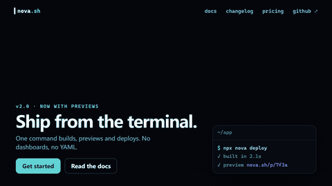

# ASCII 字符场 · `<ane-ascii-field>`



由片元着色器渲染的流动 **ASCII 字符场**。每个字符格的亮度决定字形（默认字符序列 `' .:-=+*#%@'`）；字符可以**汇聚成文字**或图片，再散回字符流；**指针下的字符会变亮**；点击会发出一圈**冲击波**。可以把你自己的内容放在元素里面叠在上层，直接当作首屏背景使用。

**[打开交互调参页 →](https://anticipate218.github.io/ai-native-effects/effects/ascii-field.html)** · [English](../../effects/ascii-field.md)（主文档）

## 安装与使用

```html
<script type="module" src="https://anticipate218.github.io/ai-native-effects/cdn/effects/ascii-field.js"></script>

<ane-ascii-field text="HELLO" text-y="0.4" style="min-height:480px;background:#05070c">
  <h1>你的首屏内容，叠在字符场上面。</h1>
</ane-ascii-field>
```

```ts
import 'ai-native-effects/ascii-field';
const field = document.querySelector('ane-ascii-field')!;
await field.morph('SHIP');   // 先散开，再汇聚成新的文字
field.shockwave();           // 从中心发出冲击波
await field.dissolve();      // 散回字符流
```

元素本身是透明的，请给它或它的容器设置深色背景。元素默认撑满容器宽度，最小高度 `260px`，可以用 `size` 或 `min-height` 修改。

## 主要参数

| 属性 | 默认值 | 说明 |
| --- | --- | --- |
| `charset` | `classic` | 字符集：`classic` / `blocks` / `binary` / `dots` / `lines` / `katakana`，或任意从暗到亮的字符串 |
| `cell` | `13` | 字形大小（CSS 像素，6–40） |
| `color` / `accent` | `#4de2c5` / `#8f7bff` | 渐变的两个颜色 |
| `text` / `reveal` / `text-y` | 无 / `1` / `0.5` | 字符汇聚成的文字（用 `\n` 换行）/ 显现程度 / 垂直位置 |
| `src` | 无 | 用图片代替文字作遮罩（需同源或允许跨域） |
| `contrast` / `scale` | `1` / `1` | 对比度 / 流动纹理的尺度 |
| `interactive` | `on` | 指针高亮与点击冲击波；`off` 关闭 |
| `quality` | `1` | 渲染分辨率；慢设备上会自动降低 |
| `seed` / `speed` / `motion` / `size` | `7` / `1` / `auto` / `260px` | 图案种子 / 速度 / 低动效 / 最小高度 |

方法：`morph(text, ms)` 变形为新文字，`dissolve(ms)` 散回字符流，`shockwave(x, y)` 发出冲击波（点击也会触发）。属性：`webgl`、`renderScale`、`time`。样式钩子：`::part(content)`。

## 无障碍与性能

- 画布只做装饰（`aria-hidden`）；设置了 `text` 时，文字会同时作为视觉隐藏文本提供给读屏软件。放在元素里的内容仍是真实的 HTML，可以选中、可以点击。
- 低动效：字符场冻结在一帧，不发冲击波，文字切换直接替换。
- 每帧 JS 只设置几个 uniform；画布最多使用 1.5 倍设备像素、140 万像素；软件渲染时从半分辨率起步，帧变慢会自动降分辨率；离屏时暂停。没有 WebGL2 时字符场为空，内容照常显示。
