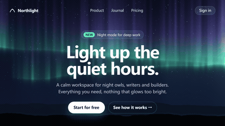

# 极光帷幕 · `<ane-aurora>`



让首屏像站在北极光下：极光帷幕从明亮的底边垂挂，竖向光柱由绿色向上过渡到紫色并淡出，帷幕随风折叠、向指针方向弯曲，星空在山脊地平线上闪烁。用一个标签包住首屏即可，里面的内容仍是普通、可访问的 HTML。

**[打开交互调参页 →](https://anticipate218.github.io/ai-native-effects/effects/aurora.html)** · [English](../../effects/aurora.md)（主文档）

## 安装与使用

```html
<script type="module" src="https://anticipate218.github.io/ai-native-effects/cdn/effects/aurora.js"></script>

<ane-aurora interactive palette="borealis" style="min-height: 100vh">
  <h1>Light up the quiet hours.</h1>
  <a class="cta" href="/signup">Start for free</a>
</ane-aurora>
```

## 主要参数

| 属性 | 默认值 | 说明 |
| --- | --- | --- |
| `palette` | `borealis` | 配色预设：`borealis` 北极光 / `dusk` 暮色 / `glacier` 冰川 / `ember` 余烬 |
| `color` / `accent` | 预设 | 底边颜色 / 顶部颜色 |
| `intensity` | `1` | 亮度 `0`–`2` |
| `rays` | `0.8` | 光柱对比度 |
| `stars` | `1` | 星星密度 |
| `horizon` | `1` | 山脊（`0` 为隐藏） |
| `grain` | `0.22` | 胶片颗粒 |
| `interactive` | 关 | 帷幕在指针附近下弯并增亮（触屏为轻点） |
| `quality` | `0.75` | 初始渲染分辨率比例；设备较慢时自动降低（最低 0.3） |
| `seed` / `size` / `speed` / `motion` | `7` / `520px` / `1` / `auto` | 形状种子 / 最小高度 / 速度 / 低动效 |

## 原理、无障碍与性能

- 单个 WebGL2 片元着色器：3 层帷幕，底边由正弦和分形噪声随时间漂移；底边之上按高度指数衰减，叠加竖向拉伸的高频噪声形成光柱；沿帷幕的慢速噪声包络形成折叠与空隙；颜色随高度由底边色过渡到顶部色；星空、山脊边缘光和柔光高光滚降。颗粒是 CSS 叠加的 SVG 噪声，在任何渲染比例下都清晰。
- 画布与颗粒为装饰性内容；插槽里的内容是原样 DOM。低动效模式显示静止的一帧，并且不响应指针。
- 默认按 75% 分辨率每帧绘制一次；离屏暂停，移除元素时释放 WebGL 上下文；不支持 WebGL2 时显示 CSS 渐变。
