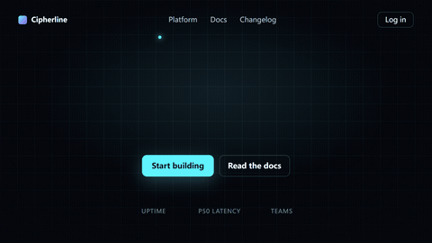

# 解码文字 · `<ane-decrypt-text>`



让标题、标签和数字从乱码中「解码」出来。与大多数乱码效果不同，**整行不会抖动**：每个字符格都保持最终字形的宽度，乱码阶段只使用实际字体中宽度相近的字形。修改文字时，会从旧字符串**平滑变形**到新字符串，多出或减少的字符格会平滑展开或收起。中日韩文字自动用对应文字的字形乱码。

**[打开交互调参页 →](https://anticipate218.github.io/ai-native-effects/effects/decrypt-text.html)** · [English](../../effects/decrypt-text.md)（主文档）

## 安装与使用

```html
<script type="module" src="https://anticipate218.github.io/ai-native-effects/cdn/effects/decrypt-text.js"></script>

<h1><ane-decrypt-text>Interfaces that</ane-decrypt-text> <ane-decrypt-text id="word">remember.</ane-decrypt-text></h1>
<span><ane-decrypt-text charset="digits">99.98%</ane-decrypt-text></span>
<a href="/docs"><ane-decrypt-text trigger="hover">阅读文档</ane-decrypt-text></a>
```

```ts
import 'ai-native-effects/decrypt-text';
document.querySelector('#word')!.text = 'react.'; // 从旧文字变形到新文字
```

元素是行内元素，会继承父元素的字体、字号、颜色，甚至 `background-clip: text` 渐变。

## 主要参数

| 属性 | 默认值 | 说明 |
| --- | --- | --- |
| `text` | 文本内容 | 文字；修改时变形 |
| `trigger` | `view` | `view` 进入视口时解码一次 / `hover` 悬停或聚焦时重新解码 / `manual` 只通过 `decode()` |
| `order` | `ltr` | 锁定顺序：`ltr` / `rtl` / `center` / `random` |
| `charset` | `latin` | 乱码字符集：`latin`（保持大小写与数字）/ `upper` / `hex` / `binary` / `digits` / `blocks` / `symbols` / `katakana` 或任意字符串 |
| `stagger` / `scramble` | `600` / `450` | 起始时间的分布范围 / 每个字的乱码时长（毫秒） |
| `accent` / `glow` | `#5ef2ff` / `1` | 乱码颜色 / 锁定闪光强度 |
| `seed` / `size` / `speed` / `motion` | `7` / 继承 / `1` / `auto` | 随机种子 / 字号 / 速度 / 低动效 |

方法 `decode()`，属性 `text`、`decoding`，事件 `ane-decrypt-done`。

## 无障碍与性能

- 读屏软件从一开始就读到最终文字（`role="text"` + `aria-label`），视觉层 `aria-hidden`，不会读出乱码。
- 低动效：不乱码，文字直接淡入；变形时直接替换。
- 纯 DOM；每帧只更新字形或状态有变化的字符格；离屏时暂停。
