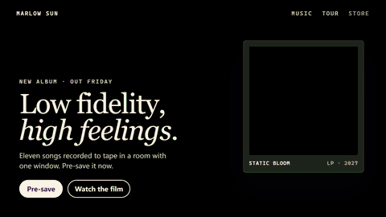

# 抖动渐变 · `<ane-dither-gradient>`



流动的渐变或任意图片，经过**限定调色板**和 **Bayer 有序抖动 / 噪声抖动**渲染，呈现印刷、孔版或老式掌机屏幕的质感。移动指针时，**透镜**里显示未经抖动的平滑原色。可以把自己的内容放在元素里面叠在上层；换一个调色板，就能从深色黄昏首屏切换到浅色印刷页面。

**[打开交互调参页 →](https://anticipate218.github.io/ai-native-effects/effects/dither-gradient.html)** · [English](../../effects/dither-gradient.md)（主文档）

## 安装与使用

```html
<script type="module" src="https://anticipate218.github.io/ai-native-effects/cdn/effects/dither-gradient.js"></script>

<ane-dither-gradient palette="sunset" style="min-height:480px">
  <h1>Low fidelity, high feelings.</h1>
</ane-dither-gradient>

<!-- 浅色印刷风 -->
<ane-dither-gradient colors="#b9a68a,#ddd0b8,#f3ecdc,#fffaf0" palette="paper"></ane-dither-gradient>

<!-- 抖动一张照片 -->
<ane-dither-gradient src="/poster.jpg" palette="mono" pixel="2"></ane-dither-gradient>
```

元素默认撑满容器宽度，最小高度 `260px`（可用 `size` 或 `min-height` 修改）。没有 WebGL2 时显示同色的 CSS 渐变。

## 主要参数

| 属性 | 默认值 | 说明 |
| --- | --- | --- |
| `colors` | 黄昏色 | 渐变色标（2–6 个十六进制颜色） |
| `palette` | `auto` | 输出颜色：`auto`（用渐变色本身）/ `sunset` / `paper` / `gameboy` / `mono` / `cga` / `ocean`，或 2–8 个颜色 |
| `pixel` | `3` | 像素大小（CSS 像素，1–16） |
| `dither` | `bayer8` | 抖动方式：`bayer8` 经典 8×8 / `bayer4` 粗颗粒 4×4 / `noise` 交错梯度噪声 |
| `spread` / `scale` | `1` / `1` | 抖动强度（0 为硬色阶）/ 流动纹理尺度 |
| `lens` / `lens-size` | `on` / `90` | 指针下的平滑原色透镜 / 透镜半径 |
| `src` | 无 | 改为抖动一张图片（需同源或允许跨域） |
| `quality` | `1` | 渲染分辨率；慢设备上自动降低 |
| `seed` / `speed` / `motion` / `size` | `7` / `1` / `auto` / `260px` | 图案种子 / 速度 / 低动效 / 最小高度 |

属性 `stops`、`palette` 返回当前使用的颜色；`webgl`、`renderScale`、`time`；样式钩子 `::part(content)`。

## 无障碍与性能

- 画布只做装饰（`aria-hidden`），放在里面的内容仍是真实 HTML。请注意文字与所选调色板的对比度；浅色调色板下，给正文加一层柔和的纸色光晕会好读很多（示例里就是这样做的）。
- 低动效：渐变静止；透镜仍可使用。
- 每帧 JS 只设置 uniform；画布最多使用 1.5 倍设备像素、140 万像素；软件渲染时从半分辨率起步，帧变慢自动降分辨率；离屏时暂停。
