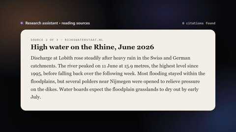

# 液态玻璃透镜 · `<ane-glass-lens>`



折射所包裹的**实时**内容的液态玻璃透镜：文字仍可选中，链接仍可点击。有三种模式：
- **`read`**：展示 AI 阅读资料的过程。透镜沿文字逐行滑过并放大，在引用的段落处停留，留下高亮，适合 RAG、研究助手和引用场景，替代「正在阅读 3 个来源…」的转圈。
- **`follow`**：桌面端跟随指针，触屏上轻点放置。
- **`static`**：由代码定位。

**[打开交互调参页 →](https://anticipate218.github.io/ai-native-effects/effects/glass-lens.html)** · [English](../../effects/glass-lens.md)（主文档）

## 安装与使用

```html
<script type="module" src="https://anticipate218.github.io/ai-native-effects/cdn/effects/glass-lens.js"></script>

<ane-glass-lens mode="read" rate="320">
  <article>
    <p>持续降雨后流量上升。<mark>11 日水位达到 15.9 米的峰值</mark>……</p>
  </article>
</ane-glass-lens>
```

```ts
import 'ai-native-effects/glass-lens';

const lens = document.querySelector('ane-glass-lens')!;
lens.addEventListener('ane-lens-mark', (e) => showCitation(e.detail.element));
lens.read();
```

被包裹的内容需要有自己的背景（卡片或图片）：透镜折射的是元素**内部**的内容，而不是元素背后的页面。

## 主要参数

| 属性 | 默认值 | 说明 |
| --- | --- | --- |
| `mode` | `follow` | `read` 阅读 / `follow` 跟随 / `static` 由 `focusOn()` 定位 |
| `marks` | `mark, [data-lens-mark]` | 需要停留并高亮的段落 |
| `rate` | `320` | 阅读速度（像素/秒） |
| `loop` | 关 | 读完后停顿再重读 |
| `strength` / `dispersion` | `0.5` / `0.4` | 折射强度 / 色散 |
| `curvature` / `bend` | `0.55` / `0.45` | 中心放大 / 边缘弯折 |
| `lens-width`、`lens-height` | 自动 | 透镜尺寸 |
| `accent` | `#7c5cff` | 高亮颜色 |
| `announce` | 关 | 找到段落时礼貌播报 |

方法：`read()`、`stop()`、`focusOn(element)`；属性：`found`；事件：`ane-lens-mark`、`ane-lens-done`。

## 原理、无障碍与性能

- 由圆角矩形有向距离场（SDF）计算位移贴图：中心向内采样以放大，边缘窄带向外采样，让附近的内容弯进边缘。SVG 滤镜（`filter: url()`，Chromium、Firefox、Safari 都支持）对内容做三次不同强度的位移以产生 RGB 色散，再还原透明度，只在透镜形状内生效，最后叠加高光边缘。
- 内容是原样的 DOM，读屏和搜索不受影响；低动效模式下透镜不滑动，引用依次高亮；触屏轻点放置透镜。
- 位移贴图只在尺寸变化时重算，每帧只更新少量属性，离屏时暂停。
