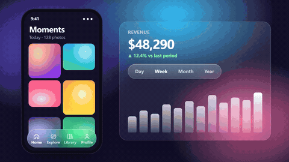

# 液态玻璃标签栏 · `<ane-glass-tabs>`



选中的标签位于一块**液态玻璃透镜**之下。透镜会**真实地折射并放大**下面的图标和文字，带一点色散。切换标签时，透镜**按弹簧滑动**，并**按速度像水滴一样拉伸**，停下后回弹成形；也可以**按住透镜拖动**，在标签之间刷选。它是完整的 tablist：漫游 tabindex、方向键切换、`aria-selected` 和切换事件都有，标签仍是你自己的按钮。

**[打开交互调参页 →](https://anticipate218.github.io/ai-native-effects/effects/glass-tabs.html)** · [English](../../effects/glass-tabs.md)（主文档）

## 安装与使用

```html
<script type="module" src="https://anticipate218.github.io/ai-native-effects/cdn/effects/glass-tabs.js"></script>

<ane-glass-tabs selected="1" aria-label="时间范围">
  <button>日</button><button>周</button><button>月</button><button>年</button>
</ane-glass-tabs>
```

```ts
import 'ai-native-effects/glass-tabs';
const tabs = document.querySelector('ane-glass-tabs')!;
tabs.addEventListener('ane-tab-change', (e) => showPanel(e.detail.index));
tabs.selected = 2; // 代码设置（不触发事件），透镜滑过去
```

元素会给自己设置 `role="tablist"`，给每个标签设置 `role="tab"`、`aria-selected` 和漫游 `tabindex`；`aria-controls` / `aria-labelledby` 请照常关联到你的面板。标签平分宽度；标签栏本身是磨砂玻璃，放在色彩丰富的背景上效果最好。

## 主要参数

| 属性 | 默认值 | 说明 |
| --- | --- | --- |
| `selected` | `0` | 选中的标签序号（用户切换后会同步更新） |
| `accent` / `tint` | `#fff` / 10% 白 | 选中文字与焦点环颜色 / 透镜底色 |
| `strength` / `curvature` / `dispersion` | `0.6` / `0.85` / `0.35` | 折射强度 / 放大程度 / 边缘色散 |
| `stretch` | `0.8` | 移动时的液体拉伸程度 |
| `speed` / `motion` | `1` / `auto` | 速度 / 低动效 |

属性 `selected`、`tabs`；事件 `ane-tab-change`（`{ index, tab }`，点击、键盘、拖动都会触发；代码设置不触发）；样式钩子 `::part(bar|lens|content)` 和 `--ane-glass-*` 变量。

## 无障碍与性能

- ARIA 标签页模式，自动激活：方向键（循环）、Home、End 同时移动焦点和选中项；焦点环使用强调色。
- 触屏：沿标签栏拖动刷选，不影响页面纵向滚动。
- 低动效：透镜直接跳到新标签，不滑动、不拉伸。
- 只用 DOM、CSS 和一个 SVG 滤镜；位移贴图按标签尺寸生成并缓存，移动时只调整位置和拉伸，不逐帧重建；透镜静止时每帧不写任何东西；离屏时暂停。
