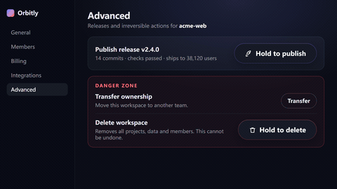

# 长按确认按钮 · `<ane-hold-button>`



**按住才能确认**，用来代替不可撤销操作前的「你确定吗？」弹窗。按住时，**带波浪前沿的液面**向前推进，按钮**微微缩小**、**光晕渐强**，接近完成时轻微**震颤**。中途松手，液面会**回流**；一直按到底，会**画出对勾**、**爆开粒子**，并可选**震动反馈**。鼠标、触屏和键盘（按住 Space 或 Enter）都可以操作。

**[打开交互调参页 →](https://anticipate218.github.io/ai-native-effects/effects/hold-button.html)** · [English](../../effects/hold-button.md)（主文档）

## 安装与使用

```html
<script type="module" src="https://anticipate218.github.io/ai-native-effects/cdn/effects/hold-button.js"></script>

<ane-hold-button done-text="已删除">按住删除</ane-hold-button>
<ane-hold-button color="#7c6cff" duration="1200" done-text="已发布">按住发布</ane-hold-button>
```

```ts
import 'ai-native-effects/hold-button';
const btn = document.querySelector('ane-hold-button')!;
btn.addEventListener('ane-hold-complete', () => deleteWorkspace());
btn.addEventListener('ane-hold-cancel', (e) => console.log('松手时进度', e.detail.progress));
btn.reset(); // 回到初始状态（比如请求失败时）
```

按钮文字就是元素里的内容（可以带图标）。按钮默认是深色胶囊样式，浅色页面可以用 `--ane-hold-bg`、`--ane-hold-fg` 调整。

## 主要参数

| 属性 | 默认值 | 说明 |
| --- | --- | --- |
| `duration` | `1500` | 需要按住的时长（毫秒） |
| `color` / `accent` | `#ff4d5e` / `#2fd39a` | 按住时的液面颜色 / 确认后的颜色 |
| `done-text` | `Done` | 确认后显示的文字（同时播报给读屏软件） |
| `reset-after` | `2400` | 确认后多久复位；`0` 表示保持确认状态 |
| `haptics` | `on` | 浏览器支持时，完成时震动；`off` 关闭 |
| `disabled` | 关 | 禁用（`aria-disabled`） |
| `size` / `speed` / `motion` | `48px` / `1` / `auto` | 高度 / 速度 / 低动效 |

事件：`ane-hold-start`（开始按住）、`ane-hold-cancel`（中途松手，`detail.progress`）、`ane-hold-complete`（已确认）。属性：`progress`、`confirmed`；方法 `reset()`；样式钩子 `::part(button|fill|label|done)`。

## 无障碍与性能

- `role="button"`，可聚焦，带 `aria-description="Press and hold to confirm"`；按住 Space / Enter 与按住指针效果相同（忽略按键自动重复）；失去焦点或指针都会取消；确认结果通过 live region 播报。
- 触屏：屏蔽长按菜单。
- 低动效：液面仍然显示进度（这是必要的反馈），但没有震颤、弹跳和粒子，对勾直接出现。
- 只用 DOM、CSS 和一块用于粒子的小 canvas；空闲时清空 canvas，按钮静止时不做任何工作。
