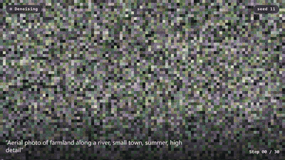

# 图像生成揭示 · `<ane-image-reveal>`



TODO：一句话说明它让 AI 产品中的哪个时刻变得可感知。

**[打开交互调参页 →](https://anticipate218.github.io/ai-native-effects/effects/image-reveal.html)** · [English](../../effects/image-reveal.md)（主文档）

## 使用

```html
<script type="module" src="https://anticipate218.github.io/ai-native-effects/cdn/effects/image-reveal.js"></script>
<ane-image-reveal></ane-image-reveal>
```

## 主要参数

| 属性 | 默认值 | 说明 |
| --- | --- | --- |
| `color` | `#7c5cff` | 主色 |
| `accent` | `#5ef2ff` | 辅色 |
| `size` | `240px` | 尺寸 |
| `speed` | `1` | 速度倍率 |
| `motion` | `auto` | 跟随系统「减少动态效果」设置 |
