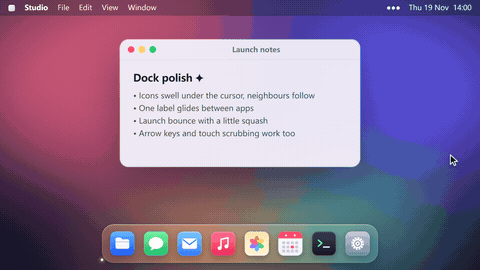

# 磁吸 Dock 栏 · `<ane-magnet-dock>`



适用于任意按钮或链接的 Dock 栏。图标在指针下以**弹簧物理放大**（带一点回弹），相邻图标平滑跟随并**向指针倾靠**；一个**共享标签在应用之间滑动**并随文字改变宽度；启动时有**挤压拉伸的弹跳**。它是真正的工具栏：方向键移动焦点并放大当前图标，触摸屏上可以沿 Dock 滑动预览。窄屏时自动缩小图标，不会撑出横向滚动条。

**[打开交互调参页 →](https://anticipate218.github.io/ai-native-effects/effects/magnet-dock.html)** · [English](../../effects/magnet-dock.md)（主文档）

## 安装与使用

```html
<script type="module" src="https://anticipate218.github.io/ai-native-effects/cdn/effects/magnet-dock.js"></script>

<ane-magnet-dock aria-label="Apps">
  <button aria-label="文件"></button>
  <button aria-label="邮件" data-active></button>
  <a href="/settings" aria-label="设置"></a>
</ane-magnet-dock>
```

```ts
import 'ai-native-effects/magnet-dock';
const dock = document.querySelector('ane-magnet-dock')!;
dock.addEventListener('ane-dock-launch', (e) => e.detail.item.toggleAttribute('data-active', true));
dock.launch(dock.items[0]); // 不点击也能弹跳，例如收到通知时
```

子元素可以是任意可聚焦元素，每个放一个图标并写上 `aria-label`（同时作为标签文字）。Dock 会统一设置子元素的尺寸、圆角，并去掉内边距、边框和背景；图标请铺满，例如 `img { width: 100%; height: 100% }`。

## 主要参数

| 属性 | 默认值 | 说明 |
| --- | --- | --- |
| `size` | `52px` | 静止时的图标尺寸 |
| `magnify` | `1.85` | 指针下图标的放大倍数（1–3） |
| `range` | `2.6` | 放大影响范围，单位为图标宽度 |
| `lean` | `0.35` | 图标向指针倾靠的程度（0–1） |
| `gap` | `10px` | 图标间距 |
| `tint` / `accent` | 14% 白 / `#fff` | 毛玻璃色调 / 焦点环与运行指示点颜色 |
| `labels` | `auto` | `none` 关闭标签；文字取自 `aria-label`、`title`、`data-label` 或文本内容 |
| `fit` | `auto` | 父元素太窄时自动缩小图标；`none` 关闭 |
| `speed` / `motion` | `1` / `auto` | 速度 / 低动效 |

子元素上的 `data-active` 显示运行指示点；方法 `launch(item)`，属性 `items`，事件 `ane-dock-launch`（`{ item }`）。

## 无障碍与性能

- `role="toolbar"` + 漫游 tabindex：只占一个 Tab 停靠点；方向键、Home、End 移动焦点，焦点图标与悬停时一样放大并显示标签。子元素保留各自的语义（按钮、链接）。
- 触摸：`touch-action: pan-y`，可以横向滑动预览，同时不影响页面纵向滚动。
- 低动效：没有弹簧、倾靠和弹跳；悬停或聚焦的图标直接变为 1.3 倍，标签原地出现。
- 纯 DOM + CSS；静止时每帧不做任何工作，离屏时暂停。
