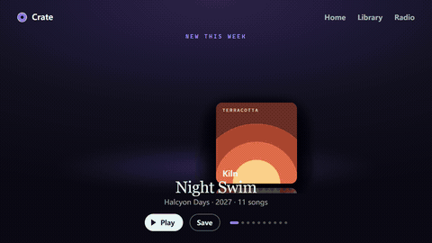

# 环绕画廊 · `<ane-orbit-gallery>`



**真实 DOM 卡片排成带俯角的 3D 圆环。** 里面可以放任何元素：图片、卡片、链接。拖拽或甩动圆环，它会带着摩擦**惯性滑行**，再**弹簧吸附**到最近的卡片。点击侧边卡片，它会**转到正面**；也可以用**方向键**或**自动播放**。越往后的卡片越小、越暗、逐渐淡出。用 Tab 进入某张卡片时，圆环会转到它；正面卡片可以略微**放大**，下方有柔和的**地面倒影**。

**[打开交互调参页 →](https://anticipate218.github.io/ai-native-effects/effects/orbit-gallery.html)** · [English](../../effects/orbit-gallery.md)（主文档）

## 安装与使用

```html
<script type="module" src="https://anticipate218.github.io/ai-native-effects/cdn/effects/orbit-gallery.js"></script>

<ane-orbit-gallery card-width="180" tilt="10" reflect aria-label="New releases">
  <a href="/albums/night-swim"></a>
  <a href="/albums/static-bloom"></a>
</ane-orbit-gallery>
```

```ts
import 'ai-native-effects/orbit-gallery';
const ring = document.querySelector('ane-orbit-gallery')!;
ring.addEventListener('ane-orbit-change', (e) => showDetails(e.detail.index));
ring.next(); // 或 ring.prev()、ring.goTo(3)、ring.index = 3
```

每个直接子元素就是一张卡片，宽度统一（`card-width`），高度跟随内容。组件只设置卡片的 transform、opacity 和 visibility，其余样式由你决定。正面卡片带 `data-current` 属性，每张卡片都有 `--ane-depth`（正面 0，背面 1），可以用来写自己的样式。

## 主要参数

| 属性 | 默认值 | 说明 |
| --- | --- | --- |
| `card-width` | `200` | 卡片宽度（px） |
| `radius` | 自动 | 圆环半径，默认按卡片数和宽度计算 |
| `tilt` | `10` | 俯角（度，-30 至 30），圆环后方抬高，正面卡片位置不变 |
| `facing` | `0.6` | 卡片随圆环转动的程度：0 始终正对你，1 沿径向 |
| `pop` / `dim` | `0.12` / `0.6` | 正面卡片额外放大 / 越往后越暗 |
| `perspective` | `1400` | CSS 透视距离，越小纵深感越强 |
| `autoplay` | `0`（关） | 每隔 N 毫秒前进一张；悬停、聚焦、拖拽时暂停 |
| `wheel` | `horizontal` | 触控板横向滚动转动圆环；`on` 任意滚轮（会拦截页面的纵向滚动）；`off` 关闭 |
| `reflect` / `accent` | 关 / `#8b7bff` | 地面倒影（Chromium 与 Safari）/ 地面光晕与焦点框颜色 |
| `size` / `speed` / `motion` | `420px` / `1` / `auto` | 高度 / 自动播放时间倍率 / 低动效 |

事件 `ane-orbit-change`（`detail.index`，拖拽过程中也会触发）；属性与方法：`index`、`goTo(i)`、`next()`、`prev()`、`position`、`moving`。

## 无障碍与性能

- 带 `role="region"` 和 `aria-roledescription="carousel"`（请用 `aria-label` 命名）。卡片带 `aria-roledescription="slide"`；没有自己标签的卡片会标为「3 of 10」。
- 宿主可聚焦：← → ↑ ↓、Home、End 转动圆环；Tab 进入卡片里的链接时，圆环会把这张卡片转到正面；停稳后播报正面卡片。
- 点击侧边卡片只会把它转过来，不会触发它的链接；转到正面后，再点击才打开链接。拖拽不会触发点击。
- 低动效：直接跳转、不旋转，没有惯性，不自动播放；拖拽仍然跟手。
- 只用 DOM 和 CSS 3D：运动时每张卡片每帧只改 transform 和 opacity，静止时不做任何工作。触屏上横向拖动转圆环，纵向仍可滚动页面。
