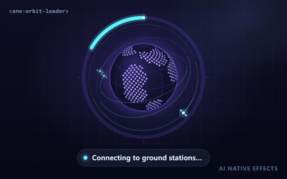

# 轨道数据加载器 · `<ane-orbit-loader>`



为 AI 与遥感产品中「最慢的环节」设计的加载器：卫星向程序化生成的星球下传数据包，进度环随之填满。下载影像、构建索引、同步数据集这类长任务，看起来是在持续工作，而不是一个卡住的转圈。支持真实进度（`progress="0.42"`）与不确定进度两种模式，并有独立的**完成**和**失败**状态。

**[打开交互调参页 →](https://anticipate218.github.io/ai-native-effects/effects/orbit-loader.html)** · [English](../../effects/orbit-loader.md)（主文档）

## 适用场景

- 下载或预处理卫星影像、地图瓦片等大体量数据。
- 构建向量索引、同步知识库、上传文件用于检索增强。
- 需要几十秒的任务：即使进度暂时不动，运动的卫星也在提示「仍在工作」。
- 先不确定（连接、排队）再切换为真实进度的流程，无需更换组件。

## 状态

| 状态 | 用法 | 表现 |
| --- | --- | --- |
| 不确定进度 | 不设置 `progress`（或 `progress = null`） | 彗星弧线绕环追逐，数据下传持续进行 |
| 确定进度 | `progress="0"`…`"1"`（或 `"0%"`…`"100%"`） | 进度弧平滑过渡到目标值，头部高亮；进度更新稀疏时也很顺滑 |
| 完成 | `progress="1"` | 冲击波从星球扩散，大陆以强调色闪亮，进度环闭合发光，下传停止；触发一次 `ane-complete` |
| 失败 | `error` 属性 | 进度环与卫星变为 `--ane-danger` 色，下传停止 |

## 安装与使用

```html
<script type="module" src="https://anticipate218.github.io/ai-native-effects/cdn/effects/orbit-loader.js"></script>

<ane-orbit-loader progress="0.42" show-value label="正在下载卫星瓦片"></ane-orbit-loader>
```

```bash
npm install github:anticipate218/ai-native-effects
```

```ts
import 'ai-native-effects/orbit-loader';

const loader = document.querySelector('ane-orbit-loader')!;
loader.addEventListener('ane-complete', () => showResults());

loader.progress = null; // 连接中：不确定进度
for await (const chunk of download(url)) loader.progress = chunk.loaded / chunk.total;
// 失败时：loader.error = true;
```

## 主要参数

| 属性 | 默认值 | 说明 |
| --- | --- | --- |
| `progress` | 无 | 进度 `0`–`1` 或 `0%`–`100%`；不设置即为不确定进度 |
| `satellites` | `3` | 卫星数量 `1`–`6` |
| `error` | 关 | 失败状态 |
| `show-value` | 关 | 在星球上显示百分比 |
| `color` | `#7c5cff` | 星球主色（海洋、陆地、经纬网、进度环轨道由它派生） |
| `accent` | `#5ef2ff` | 卫星、下传光束与进度弧颜色 |
| `size` | `240px` | 尺寸 |
| `speed` | `1` | 速度倍率，`0` 为冻结 |
| `motion` | `auto` | 跟随系统「减少动态效果」设置 |
| `label` | `Loading data` | 进度条的无障碍名称（建议本地化） |
| `seed` | `7` | 大陆形状与轨道的随机种子 |

## 无障碍与性能

- 组件以 `role="progressbar"` 暴露进度，`aria-valuetext` 依次为 `Loading` / `42%` / `Complete` / `Failed`；画布为装饰性内容（`aria-hidden`）。
- 低动效模式：星球停止自转、卫星静止，关闭下传、尾迹与冲击波，进度直接跳到目标值；不确定进度改为固定弧段的缓慢明暗呼吸。
- 单层 Canvas 2D、无依赖、无图片；星球由种子程序化生成（不使用地图数据，不涉及许可证），离屏时自动暂停。
