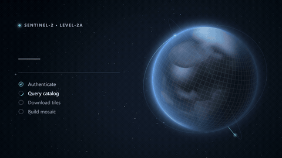

# 轨道加载界面 · `<ane-orbit-loading-screen>`



为 AI 与遥感产品中的长时间等待设计的完整加载界面，适用于拉取卫星影像、同步数据集、构建索引、启动工作区等场景。WebGL 星球被「逐块下载」：还没到达的区域显示模糊、去饱和的预览，下载完成的瓦片带着发光的前沿切换为全清晰度，卫星沿轨道扫过各自的观测带。旁边的排版面板展示百分比、步骤和实时信息。

**[打开交互调参页 →](https://anticipate218.github.io/ai-native-effects/effects/orbit-loading-screen.html)** · [English](../../effects/orbit-loading-screen.md)（主文档）

## 适用场景

- 数据密集型应用（GIS、遥感、数据分析、机器学习笔记本）的首次启动或工作区加载页。
- 需要让用户确认「确实在工作、进行到哪一步」的长时间下载和上传。
- 任何超过几秒的等待：先以不确定进度开始，拿到总量后切换为真实进度，无需更换组件。

## 状态

| 状态 | 用法 | 表现 |
| --- | --- | --- |
| 不确定进度 | 不设置 `progress` | 整个星球为模糊预览，扫描带掠过观测网格；数字位显示破折号，进度条为往返光带 |
| 下载中 | `progress="0.42"`（或 `"42%"`） | 瓦片沿斜向地面轨迹逐带、由南向北获取，新瓦片发光，卫星投下传感器扫描带；稀疏的进度更新也会平滑过渡 |
| 完成 | `progress="1"` | 网格闪亮一次后淡出，大气层泛光，所有步骤标记完成，色调切换为 `--ane-success`；触发一次 `ane-complete` |
| 失败 | `error` | 危险色调，当前步骤显示叉号，扫描停止 |

## 安装与使用

```html
<script type="module" src="https://anticipate218.github.io/ai-native-effects/cdn/effects/orbit-loading-screen.js"></script>

<ane-orbit-loading-screen
  size="520px"
  eyebrow="Sentinel-2 · Level-2A"
  heading="正在下载影像"
  steps="身份验证|检索目录|下载瓦片|生成镶嵌图"
  step="2"
  progress="0.42"
  detail="0.82 GB / 1.94 GB · 41 MB/s · 剩余 0:24"
>
  <button slot="actions">后台运行</button>
</ane-orbit-loading-screen>

<!-- 全屏启动页 -->
<ane-orbit-loading-screen fullscreen heading="正在准备工作区"></ane-orbit-loading-screen>
```

```bash
npm install github:anticipate218/ai-native-effects
```

```ts
import 'ai-native-effects/orbit-loading-screen';

const screen = document.querySelector('ane-orbit-loading-screen')!;
screen.addEventListener('ane-complete', () => screen.remove());
screen.progress = null; // 总量未知时为不确定进度
for await (const chunk of download(url)) screen.progress = chunk.loaded / chunk.total;
// 失败时：screen.error = true;
```

## 主要参数

| 属性 | 默认值 | 说明 |
| --- | --- | --- |
| `progress` | 无 | `0`–`1` 或 `0%`–`100%`；不设置为不确定进度 |
| `heading` | `Preparing your workspace` | 主标题，变更时淡入 |
| `eyebrow` | `Loading` | 标题上方的小号大写行，带状态指示灯 |
| `steps` / `step` | 无 / `0` | 以 `\|` 分隔的步骤名称 / 当前步骤（从 0 开始） |
| `detail` | 无 | 次要信息：大小、速度、剩余时间 |
| `status` | 无 | 等宽日志行（高度较小时隐藏） |
| `error` | 关 | 失败状态 |
| `satellites` | `2` | 卫星数量 `0`–`4` |
| `accent` | `#5ef2ff` | 新瓦片、扫描带、进度条与步骤标记颜色 |
| `color` | `#6aa6ff` | 大气层与预览色调 |
| `fullscreen` | 关 | 覆盖整个视口 |
| `size` | `480px` | 高度；宽度跟随容器，窄于 640px 时上下堆叠 |
| `quality` | `auto` | WebGL 分辨率，`auto` 会在设备较慢时自动降低 |
| `speed` / `motion` / `seed` / `label` | | 速度倍率 / 低动效 / 随机种子 / 无障碍名称 |

插槽 `actions` 用于放置「取消」「后台运行」等按钮；`::part(screen)`、`::part(panel)` 可用于自定义样式。

## 无障碍与性能

- 面板是真实的 DOM 文本。进度条为 `role="progressbar"`，以标题命名，`aria-valuetext` 依次为 `Loading` / `42%` / `Complete` / `Failed`。步骤是有序列表，当前步骤带 `aria-current="step"`，并附有供读屏读出的状态文字。
- 低动效模式：星球、云层和卫星静止，关闭扫描带、星光闪烁和完成闪光，进度直接跳到目标值；瓦片仍会填充，进度依然可见。
- 分为三层：只覆盖星球与光晕的 WebGL2 画布、绘制轨道的 2D 画布、DOM 文本。星球纹理按种子一次性烘焙；每帧只有一次全画布绘制，JS 开销低于 1 ms。离屏时暂停，移除元素时释放 WebGL 上下文；不支持 WebGL2 时回退为 2D 绘制的星球。
