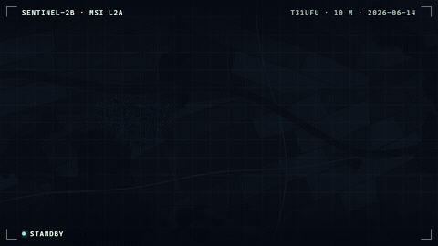

# 卫星扫描揭示 · `<ane-scan-reveal>`



遥感产品里有两段等待：影像到达，以及模型处理影像。`<ane-scan-reveal>` 把两者都变成卫星扫描。推扫式传感器线揭示影像，线后的波段错位色散和探测器条带噪声随即「定标」消退；接着一条虚线推理扫描把模型的地物分类掩膜叠加到影像上，类别边界清晰，新检测出的区域会先亮起来。HUD 提供取景框、传感器标签、实时状态和图例。

可以传入自己的影像和掩膜；不设置 `src` 时，会按种子生成一景农田场景（地块、树篱、河流、森林、城镇）及对应的类别掩膜，不涉及影像许可。

**[打开交互调参页 →](https://anticipate218.github.io/ai-native-effects/effects/scan-reveal.html)** · [English](../../effects/scan-reveal.md)（主文档）

## 两种模式

| 模式 | 用法 | 表现 |
| --- | --- | --- |
| 自动播放 | 不设置 `progress` | 按 `duration` 播放获取扫描，再播放推理扫描（时长为前者的 85%）；`loop` 循环，`replay()` 重播 |
| 应用驱动 | 设置 `progress`（及 `analysis`） | 由应用上报真实进度（瓦片加载数、推理步数），两次更新之间平滑过渡 |

## 安装与使用

```html
<script type="module" src="https://anticipate218.github.io/ai-native-effects/cdn/effects/scan-reveal.js"></script>

<!-- 程序化场景 + HUD，自动播放 -->
<ane-scan-reveal hud loop caption="Sentinel-2B · MSI L2A" detail="T31UFU · 10 m"></ane-scan-reveal>

<!-- 自己的影像与模型输出 -->
<ane-scan-reveal hud src="scene.jpg" mask="landcover.png"
  classes="水体:#4cc9f0|建成区:#ffb547|林地:#3ddc97" alt="莱茵河三角洲 Sentinel-2 真彩色影像与地物分类"></ane-scan-reveal>
```

```ts
import 'ai-native-effects/scan-reveal';

const scan = document.querySelector('ane-scan-reveal')!;
scan.progress = tilesLoaded / tilesTotal; // 获取扫描
scan.analysis = stepsDone / stepsTotal;   // 推理扫描
scan.addEventListener('ane-scan-complete', (e) => console.log(e.detail.pass));
```

掩膜图片与影像同尺寸（或同比例），每个类别一种颜色，其余透明。跨域图片需要服务端提供 CORS 头，否则 WebGL 无法读取，组件会退回为不带特效的 2D 擦除。

## 主要参数

| 属性 | 默认值 | 说明 |
| --- | --- | --- |
| `src` / `mask` | 程序化场景 | 影像 / 类别掩膜 |
| `alt` | `Satellite image` | 影像描述（建议本地化） |
| `progress` / `analysis` | 无 / `0` | 获取 / 推理进度 `0`–`1` |
| `duration` / `loop` | `3600` / 关 | 自动播放单段时长（毫秒）/ 循环 |
| `hud`、`caption`、`detail` | 关 | HUD 与左上、右上标签 |
| `classes` | 水体、建成区、森林 | 图例，格式 `名称:#色值\|…` |
| `accent` | `#5ef2ff` | 扫描线颜色 |
| `angle` | `-9` | 地面轨迹倾角（度） |
| `ghost` | `0.18` | 未获取区域的预览可见度 |
| `ratio` / `seed` / `size` | 影像比例 / `7` / `100%` | 宽高比 / 场景种子 / 宽度 |

## 无障碍与性能

- 画布为 `role="img"`，由 `alt` 描述；隐藏的 progressbar 报告整体进度，`aria-valuetext` 例如「Analyzing 40%」「Complete」。
- 低动效：自动播放直接显示完成状态；应用驱动时扫描仍随进度推进，但边缘为硬切，没有色散、条带、辉光和流动虚线。
- 每帧只有一次 WebGL 绘制，而且只在画面变化时绘制，扫描静止时不重绘；程序化场景按种子只烘焙一次；离屏时暂停，移除元素时释放 WebGL 上下文。
