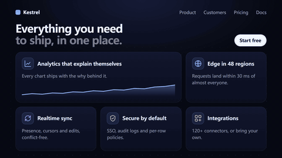

# 聚光卡片墙 · `<ane-spotlight-grid>`



**整面卡片墙共享一束光。** 光带着一点惯性跟随指针，按距离点亮卡片边框，所以相邻卡片也会越过间隙一起被照亮。卡片后面的**点阵**只在光照范围内显现，卡片表面有一层柔和的**光泽**。点击会发出一圈**光波**，扫过的卡片边框依次亮起。无人操作时，光会**缓慢游走**。卡片是你自己的 HTML，把元素本身当作网格容器来写样式即可。

**[打开交互调参页 →](https://anticipate218.github.io/ai-native-effects/effects/spotlight-grid.html)** · [English](../../effects/spotlight-grid.md)（主文档）

## 安装与使用

```html
<script type="module" src="https://anticipate218.github.io/ai-native-effects/cdn/effects/spotlight-grid.js"></script>

<ane-spotlight-grid style="display:grid;grid-template-columns:repeat(3,1fr);gap:12px;padding:14px">
  <article class="card" style="grid-column:span 2">…</article>
  <article class="card">…</article>
  <article class="card">…</article>
</ane-spotlight-grid>
```

```ts
import 'ai-native-effects/spotlight-grid';
const wall = document.querySelector('ane-spotlight-grid')!;
wall.pulse();          // 从中心发出光波
wall.pulse(120, 80);   // 或从指定位置（元素内坐标）
```

建议：卡片用**不透明**背景，这样点阵只出现在间隙里；元素本身留一点 `padding`，光在卡片墙四周也有空间。发光边框会沿用每张卡片自己的 `border-radius`。

## 主要参数

| 属性 | 默认值 | 说明 |
| --- | --- | --- |
| `color` / `accent` | `#8ab4ff` / `#c58bff` | 光的颜色 / 点阵、光波和光外圈的色调 |
| `radius` | `340px` | 光照半径 |
| `intensity` | `1` | 亮度（0–1） |
| `border` | `1.5px` | 发光边框宽度 |
| `sheen` | `0.75` | 卡片表面光泽（0–1） |
| `dots` / `dot-gap` | `on` / `22px` | 点阵开关 / 点阵间距 |
| `idle` | `on` | 无人操作时缓慢游走；`off` 关闭 |
| `speed` / `motion` | `1` / `auto` | 速度 / 低动效 |

方法 `pulse(x?, y?)` 发出光波（点击也会触发）；属性 `cards` 返回卡片列表；样式钩子：`::part(background)` 和 `--ane-spot-*` 变量。

## 无障碍与性能

- 光效层只做装饰（`aria-hidden`），卡片保留各自的语义；聚焦某张卡片（或卡片内的元素）时，光会移到这张卡上。
- 触摸：拖动移动光源，点按发出光波。
- 低动效：光没有惯性、不游走、不发光波。
- 纯 DOM + CSS；每帧只写少量 CSS 变量，卡片位置只在尺寸变化时测量；离屏时暂停。
