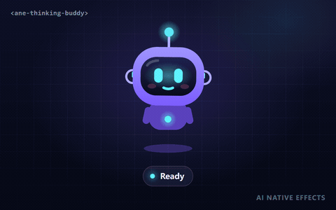

# AI 思考小伙伴 · `<ane-thinking-buddy>`



一个小机器人，让智能体的执行状态一眼可读。每个状态都有独立的**肢体语言**和**状态徽标**，用户无需阅读文字就能区分「思考中」「等待工具返回」与「已完成」。

**[打开交互调参页 →](https://anticipate218.github.io/ai-native-effects/effects/thinking-buddy.html)** · [English](../../effects/thinking-buddy.md)（主文档）

## 适用场景

- 聊天助手 / Copilot：放在输入框旁或最新消息旁。
- 智能体控制台：每个任务或每个 worker 一个小伙伴。
- 长耗时任务（代码生成、数据处理、部署），进度条无法给出准确进度时。
- 空状态与新手引导，用友好的角色定下产品基调。

## 状态

| 状态 | 肢体语言 | 徽标 | 建议对应的事件 |
| --- | --- | --- | --- |
| `idle` 空闲 | 轻轻悬浮、随机眨眼和张望 | 无 | 就绪，没有任务在运行 |
| `thinking` 思考 | 抬眼、歪头、耳朵转盘旋转、天线闪烁 | 带跳动圆点的思考气泡 | 模型生成或规划中 |
| `waiting` 等待 | 看向沙漏、手臂轻拍 | 翻转的沙漏 | 工具调用中、限流、等待审批或用户输入 |
| `success` 成功 | 挤压拉伸的跳跃、笑眼、彩纸 | 自动描绘的对勾 | 最终回答已给出、任务完成 |
| `error` 失败 | 摇头、`> <` 眼、天线下垂冒火花、流汗 | 摆动的感叹号 | 异常、工具调用失败、请求被拒绝 |

每次切换 `state` 都会先播放一次进入动作（跳跃、摇头），然后进入循环动画。调用 `replay()` 可再次播放进入动作。

## 安装与使用

```html
<script type="module" src="https://anticipate218.github.io/ai-native-effects/cdn/effects/thinking-buddy.js"></script>

<ane-thinking-buddy state="thinking" size="120px"></ane-thinking-buddy>
```

```bash
npm install github:anticipate218/ai-native-effects
```

```ts
import 'ai-native-effects/thinking-buddy';

const buddy = document.querySelector('ane-thinking-buddy')!;
buddy.labels = {
  idle: 'AI 助手空闲',
  thinking: 'AI 助手正在思考',
  waiting: 'AI 助手正在等待',
  success: 'AI 助手已完成',
  error: 'AI 助手出错了',
};

agent.on('start', () => (buddy.state = 'thinking'));
agent.on('tool_call', () => (buddy.state = 'waiting'));
agent.on('done', () => (buddy.state = 'success'));
agent.on('error', () => (buddy.state = 'error'));
```

## 主要参数

| 属性 | 取值 | 默认值 | 说明 |
| --- | --- | --- | --- |
| `state` | `idle` `thinking` `waiting` `success` `error` | `idle` | 当前状态，未知值回退为 `idle` |
| `color` | 任意 CSS 颜色 | `#7c5cff` | 机身颜色，高光与阴影自动推导 |
| `accent` | 任意 CSS 颜色 | `#5ef2ff` | 眼睛、嘴巴与发光颜色 |
| `size` | CSS 长度 | `160px` | 宽高 |
| `speed` | `0`–`5` | `1` | 动画速度倍率，`0` 为冻结 |
| `motion` | `auto` `reduce` `full` | `auto` | `auto` 跟随系统「减少动态效果」设置 |
| `interactive` | 布尔 | 关 | 眼睛跟随指针，点击会开心地弹一下 |
| `announce` | 布尔 | 关 | 通过礼貌型 live region 向读屏器播报状态变化 |
| `label` | 字符串 | 按状态 | 覆盖无障碍标签 |
| `seed` | 整数 | `7` | 眨眼、张望、彩纸的随机种子 |

事件 `ane-statechange` 的 `detail` 为 `{ state, previous }`，会冒泡并穿过 Shadow DOM。

CSS 变量：`--ane-size`、`--ane-buddy-color`、`--ane-buddy-accent`、`--ane-success`、`--ane-warning`、`--ane-danger`。

## 无障碍与性能

- SVG 带有 `role="img"` 和随状态变化的 `aria-label`，可用 `labels` 本地化。
- 开启「减少动态效果」后不再悬浮、跳跃、摇头和撒彩纸，但表情、徽标和颜色仍会变化，状态依然可读。
- 徽标不只依赖颜色：每个状态的图形都不同（云朵、沙漏、对勾、感叹号）。
- 纯 SVG、节点数量固定，每帧只更新 transform 与 opacity；离开视口自动暂停。端到端测试要求每帧平均 JS 耗时低于 2ms。

完整 API 与 TypeScript / React 类型声明示例见 [英文文档](../../effects/thinking-buddy.md)。
