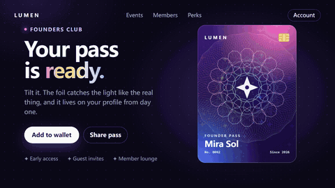

# 全息倾斜卡片 · `<ane-tilt-holo-card>`



**随指针弹簧倾斜**的卡片，像真正的全息印刷一样反光。程序化**箔纹**（星点、细纹或鳞片）只在光照到的地方显出彩虹；一条宽的**虹彩光带**和**高光**跟随指针移动；**描边**流光，投影朝相反方向移动。卡片里放你自己的 HTML。无人操作时卡片**轻微摆动**；手机上可以跟随**陀螺仪**。

**[打开交互调参页 →](https://anticipate218.github.io/ai-native-effects/effects/tilt-holo-card.html)** · [English](../../effects/tilt-holo-card.md)（主文档）

## 安装与使用

```html
<script type="module" src="https://anticipate218.github.io/ai-native-effects/cdn/effects/tilt-holo-card.js"></script>

<ane-tilt-holo-card ratio="5/7">
  
</ane-tilt-holo-card>

<ane-tilt-holo-card foil="scales" size="280px" gyro>
  <a href="/pass" class="pass-face"><span>创始会员</span><strong>Mira Sol</strong></a>
</ane-tilt-holo-card>
```

卡片会按圆角裁切内容；不设 `ratio` 时高度由内容决定。默认的 `color-dodge` 箔纹在深色画面上最亮；浅色卡片可以试试 `blend="screen"` 或 `blend="soft-light"`。

## 主要参数

| 属性 | 默认值 | 说明 |
| --- | --- | --- |
| `size` | `300px` | 卡片宽度（不会超过容器宽度） |
| `tilt` | `16` | 最大倾斜角度（0–35°） |
| `foil` | `sparkle` | 箔纹：`sparkle` 星点 / `lines` 细纹 / `scales` 鳞片 / `none`（彩虹覆盖整张卡） |
| `foil-strength` / `sheen` / `glare` | `0.85` / `0.55` / `0.8` | 箔纹彩虹 / 虹彩光带 / 白色高光的强度 |
| `blend` | `color-dodge` | 箔纹混合模式：`screen`、`overlay`、`soft-light`、`hard-light`、`plus-lighter` |
| `hue` | `0` | 彩虹色相偏移（度） |
| `radius` / `ratio` / `perspective` | `18px` / 由内容决定 / `800px` | 圆角 / 宽高比（如 `5/7`）/ 透视深度 |
| `idle` | `on` | 无人操作时轻微摆动；`off` 关闭 |
| `gyro` | 关 | 手机上跟随设备朝向；iOS 会在首次点按卡片时申请权限 |
| `seed` / `speed` / `motion` | `7` / `1` / `auto` | 箔纹随机种子 / 速度 / 低动效 |

只读属性 `tiltAngles` 返回当前的 `[rotateX, rotateY]`；样式钩子：`::part(card|foil|sheen|glare|shadow|stage)`、`--ane-holo-bg`、`--ane-holo-radius`。

## 无障碍与性能

- 卡片本身只做装饰，内容保留各自的语义；卡片内的链接或按钮获得焦点时，卡片会像悬停一样倾斜。
- 触摸：在卡片上拖动即可倾斜，同时不影响页面纵向滚动。
- 低动效：不倾斜、不摆动、不抬起；箔纹固定在一个角度，只在悬停或聚焦时变亮。
- 纯 DOM + CSS（canvas 只用来生成一次箔纹贴图）；每帧只写 6 个 CSS 变量，弹簧静止后停止写入；离屏时暂停。
