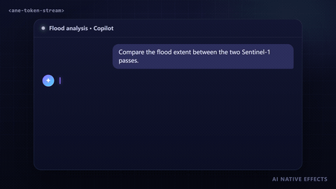

# 流式文本 · `<ane-token-stream>`



LLM 的流式回答总是不均匀地到达：几个 token、一次停顿、再一下子来一整段。原样拼接，文字就会一顿一顿地跳。`<ane-token-stream>` 先把分块放进缓冲，再以自适应的节奏释放每个词，让它从模糊中浮起，由强调色「晾干」为正文色，前方有一个发光的光标。输出是真实、可选中的文本，中文、日文、英文都适用。

**[打开交互调参页 →](https://anticipate218.github.io/ai-native-effects/effects/token-stream.html)** · [English](../../effects/token-stream.md)（主文档）

## 工作原理

1. **安全切分**：`write(chunk)` 写入缓冲，只输出不会再变化的单元。没写完的词、未闭合的 `` `代码` ``、单独的 `*`、末尾的换行（之后可能变成段落）都会等下一块到达。
2. **分词**：使用 `Intl.Segmenter`，中文这类没有空格的文字也能按词切分；标点跟随前一个词，逗号不会出现在行首。`char` 模式下先排好整个词再逐字显示，不会重排，也不会断词。
3. **自适应节奏**：按 `rate`（字符/秒）发放预算；积压时速率自动提高，时间常数约 0.8 秒，突发的大段文本不会让读者落后太多。
4. **落墨**：新单元在约 460 ms 内从模糊、略微下沉、强调色，变为清晰、归位、正文色；每帧只处理仍在动画中的单元。
5. **光标**：等待时呼吸，书写时常亮，`done()` 后淡出；一团柔光跟随书写位置。

## 安装与使用

```html
<script type="module" src="https://anticipate218.github.io/ai-native-effects/cdn/effects/token-stream.js"></script>

<ane-token-stream rate="60"></ane-token-stream>
```

```bash
npm install github:anticipate218/ai-native-effects
```

```ts
import 'ai-native-effects/token-stream';

const answer = document.querySelector('ane-token-stream')!;

// 直接接 fetch 的响应体（字节或文本）
await answer.stream(response.body!);

// 或者逐块写入
answer.reset();
for await (const delta of client.stream(prompt)) answer.write(delta);
answer.done();
answer.addEventListener('ane-stream-end', (e) => save(e.detail.text));
```

## 主要参数

| 属性 | 默认值 | 说明 |
| --- | --- | --- |
| `rate` | `60` | 基础速度（字符/秒），积压时自动加快 |
| `granularity` | `word` | 显示单位：`word` 按词，`char` 按字 |
| `caret` | `auto` | `auto` 结束后淡出；`persist` 保持呼吸；`none` 不显示 |
| `color` | `currentColor` | 文字颜色 |
| `accent` | `#7c5cff` | 墨迹、光标、光晕和代码底色 |
| `size` | 继承 | 字号 |
| `speed` / `motion` | `1` / `auto` | 速度倍率 / 低动效 |
| `announce` | 关 | 结束时通过礼貌型 live region 播报「Response complete」 |
| `label` | `Assistant response` | 文本区域的无障碍名称（建议本地化） |

方法：`write()`、`done()`、`stream()`、`skip()`、`reset()`；属性：`text`、`streaming`、`finished`；事件：`ane-stream-end`。支持换行、空行分段、`` `行内代码` `` 和 `**粗体**`。完整的 Markdown（表格、列表、代码块）建议在流结束后交给自己的渲染器处理。

## 无障碍与性能

- 文本是真实的 DOM，流式期间区域带 `aria-busy="true"`，读屏软件不会读出写到一半的句子，结束后恢复为 `false`。
- 低动效模式保留节奏（这是内容本身的到达），去掉模糊、位移、变色、光晕和闪烁，新词只做短暂淡入。
- 不用画布、无依赖；每帧只更新正在动画的少数单元，完成的文字不带内联样式；离屏时自动暂停。
