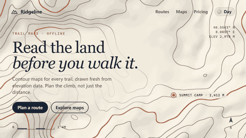

# 流动等高线 · `<ane-topography>`



**一张会动的等高线地图背景。** 用缓慢漂移的高程场实时绘制清晰的等高线、加粗的**计曲线**、按高程分层的**设色**和柔和的**晕渲**。移动指针，光标下会**隆起一座山**，等高线收拢成环；点击或轻触会投下一圈**涟漪**。有浅色**纸面**和深色主题，切换时**平滑过渡**。可以把自己的内容放在里面。

**[打开交互调参页 →](https://anticipate218.github.io/ai-native-effects/effects/topography.html)** · [English](../../effects/topography.md)（主文档）

## 安装与使用

```html
<script type="module" src="https://anticipate218.github.io/ai-native-effects/cdn/effects/topography.js"></script>

<ane-topography style="min-height: 520px">
  <h1>Read the land before you walk it.</h1>
</ane-topography>
<ane-topography theme="night" levels="20" fill="0.3"></ane-topography>
```

```ts
import 'ai-native-effects/topography';
const map = document.querySelector('ane-topography')!;
map.setAttribute('theme', 'night'); // 平滑切换到深色预设
map.ripple(320, 180, 1.5);          // 从某一点（元素内 CSS 像素）投下涟漪
```

元素是块级元素，宽度撑满；高度需要你给（`min-height`、`size` 或布局）。放进去的内容会显示在地图上方。

## 主要参数

| 属性 | 默认值 | 说明 |
| --- | --- | --- |
| `theme` | `paper` | 主题：`paper`（浅色纸面）/ `night` / `blueprint` / `moss`，切换时平滑过渡 |
| `background` / `color` / `accent` | 跟随主题 | 纸面颜色 / 等高线颜色 / 计曲线颜色（十六进制） |
| `levels` | `14` | 等高线密度（4–40） |
| `line-width` / `index` | `1.2` / `5` | 线宽（CSS px）/ 每隔几条画一条计曲线（0 = 不画） |
| `scale` | `1` | 地形尺度（越大起伏越细碎） |
| `relief` / `ripples` | `1` / `on` | 指针处山丘的高度（0 = 关闭）/ 点击涟漪 |
| `fill` / `shade` / `grain` | `0.5` / `0.4` / `0.35` | 分层设色 / 晕渲 / 纸纹 |
| `speed` | `1` | 只控制地形漂移速度；`0` 是静止地图，但山丘和涟漪仍然响应指针 |
| `quality` / `seed` / `motion` / `size` | `1` / `11` / `auto` / `260px` | 渲染精度（慢设备上会自动降低）/ 地形种子 / 低动效 / 最小高度 |

方法 `ripple(x, y, strength?)`；属性 `webgl`、`colors`；样式钩子 `::part(content)`。

## 原理

- 等高线：把「高程 × 层数」与最近的整数比较，再除以它的屏幕空间导数（`fwidth`），得到任意坡度下像素宽度恒定、抗锯齿的线条，不需要提取几何。线条间距小于约 3 px 时自动淡出，避免摩尔纹。
- 制图惯例：每隔 N 条加粗一条计曲线；按高程分层设色；用同一组导数计算左上方光照的晕渲。
- 高程场用线性拉伸，不做截断：被截断的平台会恰好落在一条等高线上，整片被涂满颜色。

## 无障碍与性能

- 画布只作装饰（`aria-hidden`），你的内容仍是可选中、可访问的普通 DOM。
- 低动效：地形冻结，没有涟漪；山丘仍跟随指针，但不做缓动。
- 只有一个全屏片元着色器：渲染分辨率有上限（DPR ≤ 1.5、约 140 万像素），软件渲染器上从半分辨率起步，帧率低时自动降级，离开屏幕时暂停。没有 WebGL2 时显示 CSS 回退（主题色和淡淡的同心环）。
